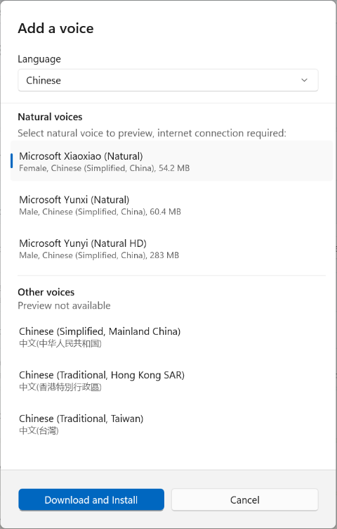
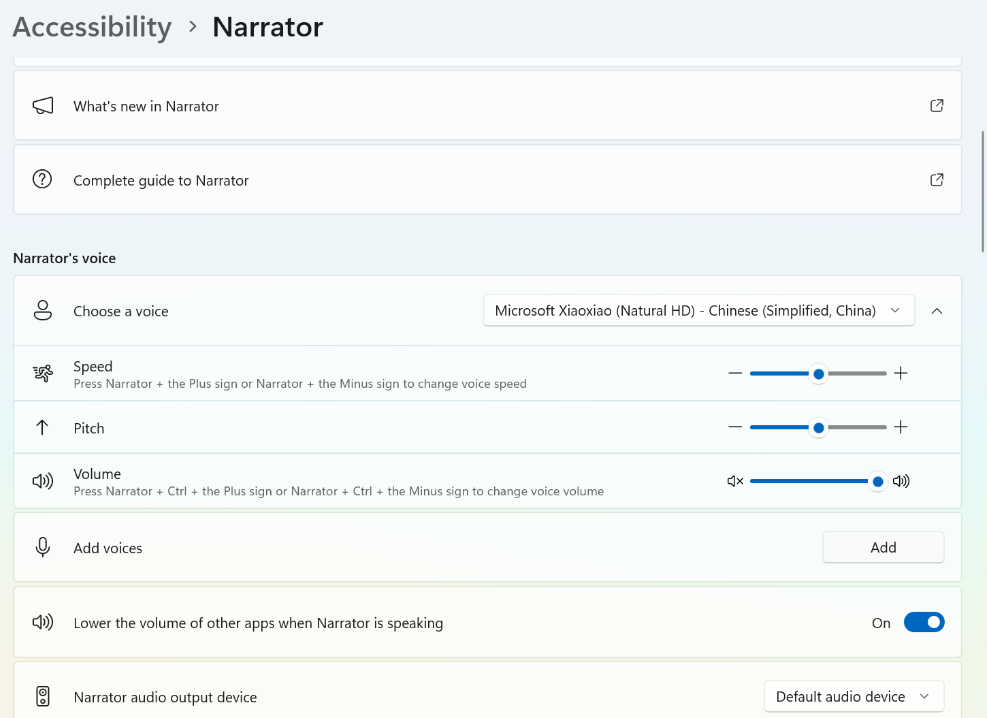
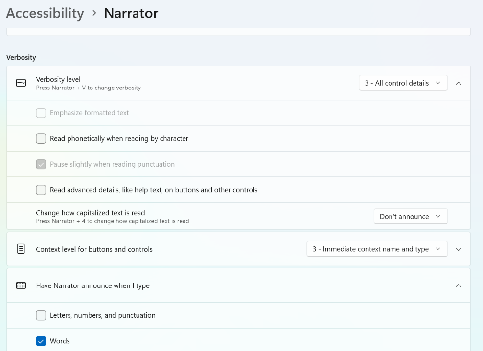

# 显示、皮肤、关怀模式与讲述人 / Display, skins, Comfort mode, and Narrator

## 桌面端使用

打开开始菜单中的 **奇奇五笔设置**，在“显示与易读”中选择：

| 选项 | 行为 |
|---|---|
| 跟随系统 | 按界面分别跟随 Windows 模式或应用模式；桌面端默认值 |
| 明亮 | 固定明亮主题 |
| 深色 | 固定深色主题 |
| 高对比度 | 应用自己的黑底、白字、黄色强调配色 |
| 文字大小 | 100%、125%、150%、200%，默认 100% |
| 关怀模式 | 开启时将小于 150% 的字号提高到 150%，增大操作区域及间距 |

主题是**可选项**，无需修改 Windows 设置。Windows 已启用高对比度时，
其系统颜色始终优先；关闭系统高对比度后恢复应用所选主题。

Windows 11 和 Windows 10 1903 及后续版本均支持分开的 **Windows mode**
和 **App mode**，在“个性化 → 颜色 → 自定义”中可分别选择明亮或深色。
“跟随系统”按以下界面边界选择配色：

| 界面 | 主题来源 |
|---|---|
| 设置、词库管理器、Log Monitor 等独立工具及其菜单 | App mode（`AppsUseLightTheme`） |
| 输入法自绘候选窗、设置内的候选样式预览 | App mode（`AppsUseLightTheme`） |
| 输入法自绘右键菜单 | Windows mode（`SystemUsesLightTheme`） |
| 浮动状态条本体及其 Tooltip | App mode（`AppsUseLightTheme`） |

由输入法打开的设置等工具仍按工具规则处理；状态条打开的自绘右键菜单
则按输入法菜单规则处理。明亮、深色和手选高对比度不受这两项自动来源影响，
Windows 系统高对比度仍优先。任务栏“中/英”模式图标继续独立跟随 Windows mode，
不随手选界面主题改变；品牌图标和宿主接管的界面不属于此自动配色承诺。
两项注册表设置见[微软设置参考](https://learn.microsoft.com/windows/apps/develop/settings/settings-common#personalization---colors)。
候选窗当前不区分普通应用与 Windows 系统输入界面，均使用 App mode；
系统界面识别及 Windows mode 特例保留为后续 TODO，不按进程名推测宿主主题。

关怀模式开启时字号只能选择 150% 或 200%，100%/125% 灰显不可选。
关闭关怀模式后恢复所有字号选项，保留当前字号。文字区域不切换模式；
仅点击开关本身可切换，也可用键盘操作。
关怀模式开关位于文字大小上方；禁用字号使用明显的灰色文字。
字号与显示器 DPI 分开计算，移动到不同缩放比例的屏幕时重新布局。

更改先在设置窗口及其候选样式示例中预览：

- **确定**：保存并经现有配置通知更新输入法自绘候选窗。
- **取消**或关闭：丢弃尚未保存的显示修改。
- **恢复默认设置**：统一恢复显示、词库、输入习惯等设置，仍须确定保存。
- 保存失败会明确提示并保留当前编辑，可重试。

设置按“输入习惯、词库、候选窗口、显示与易读、声音与反馈”五个 Tab 分类。
Tab 栏的背景、文字、选中态、焦点及横向翻页箭头使用所选主题；
字号放大后空间不足时，使用箭头或 Ctrl+Tab / Ctrl+Shift+Tab 切换。
只有当前页显示并滚动；切换页保留未保存的修改和各页滚动位置。
页面中的标签和控件在空间不足时上下排列。
About、Shortcuts、恢复默认设置、确定/取消按此顺序固定在底栏，所有 Tab 可用；
常规宽度并列，字号放大或窗口较窄时底栏分两行。
导入配置和导出配置位于现有“词库”页，不额外挤占固定底栏。
下拉框采用固定基础宽度并右对齐；页大小与候选排列方式并排显示。
操作按钮紧凑排列，候选预览以横向布局节省空间，空间不足时换行。
Browse 和 Dictionary Manager 与自定义主词库选项并排，空间不足时移到其下一行。
仅选中自定义主词库时 Browse 可用，Dictionary Manager 不受该选项限制。
单击 Custom 仅选中该方案并启用 Browse，不自动打开文件对话框；
使用 Browse 选择文件后才能保存有效的自定义词库配置。
Extra 缩进显示在 Jidian Core 下，并注明依赖关系：只有选中 Core 时可用。
切换其他词库会自动取消 Extra 勾选并禁用；切回 Core 后须手动重新勾选。
禁用时 Browse 文字、Extra 标签及开关使用与禁用字号一致的灰色，高对比度下遵循对应配色。
高对比度下不只依靠颜色：禁用按钮和开关增加“不可用 / Unavailable”状态文字，
移除其外框；禁用字号项追加同样的状态提示，保持系统配色及文字可读性。
可使用 Tab/Shift+Tab 移动焦点，空格操作开关，方向键选择下拉项；
焦点进入屏外控件时自动滚动。易读主要操作目标不小于 44×44 DIP。
开关的焦点提示仅围绕开关本体，不包围整行标签。

### 配置 JSON 导入与导出

“词库”页的“导出配置 / Export config”将当前窗口中的配置（含尚未保存的编辑）
原子写入 UTF-8 `.json`，不改变已保存配置。文件可手工编辑，不要求校验和。
“导入配置 / Import config”完整校验文件后打开独立模态变更预览，
显示每个变更的设置名称、JSON 字段名及前后值，长内容可滚动、选择和复制。
点击“加载配置 / Load config”只加载编辑；仍须在设置窗口点击“确定”保存。
取消预览保留先前编辑，取消设置则放弃全部未保存修改。导入不新增 Tab。
保存失败保留原注册表配置与当前编辑，显示实际 HRESULT，可重试。

文件结构示例（未列出的设置保持当前值）：

```json
{
  "format": "qiqiime-config",
  "version": 1,
  "settings": {
    "page_size": 7,
    "enable_code_completion": false,
    "ui_theme": "system"
  }
}
```

`format`、整数 `version: 1` 和 `settings` 对象为必需项；开关使用 JSON
布尔值，`page_size` 使用 1–9 的整数。枚举名称区分大小写：

| 字段 | 支持的名称 |
| --- | --- |
| `primary_dict` | `jidian`, `haifeng`, `builtin`, `custom` |
| `candidate_layout` | `horizontal`, `vertical` |
| `ui_language` | `auto`, `zh-CN`, `en-US` |
| `underline_style` | `dot`, `solid`, `dash`, `squiggle`, `none` |
| `ui_theme` | `system`, `light`, `dark`, `high_contrast` |
| `ime_skin_id` | `default` 或[皮肤目录](ime-skin-palettes.md)中的稳定 ID |
| `ui_text_scale` | `100%`, `125%`, `150%`, `200%` |

关怀模式 `easy_reading: true` 要求最终字号至少 `150%`；如当前字号较小，
部分导入须同时提供 `ui_text_scale`。自定义主词库不携带文件或路径，
导入 `custom` 前须在本机选择主词库，保存时沿用词库有效性检查。
只支持[共用配置字段表](../src/common/config.h)列出的标量字段，
包括窗口未单独展示的默认输入模式与临时英文开关；词库路径、词库内容、
任意注册表项均不可导入。配置文件不超过 64 KiB，允许 UTF-8 BOM；
拒绝非法 UTF-8/JSON、重复或未知字段、类型错误、越界值及未知版本，
显示具体字段和错误位置，不在日志中记录导入内容。
独立 JSON 只包含配置，不替代词库与调频数据。词库管理器的完整备份使用
Deflate 压缩的 ZIP（`.zip`，由 miniz 读写），其中包含 `manifest.json`、`config.json`、用户词库规则、
词组排序文本；当前选择自定义主词库时还包含 `custom-primary.txt`。
清单使用固定的可移植文件名，不写入机器绝对路径。恢复前会完整校验 ZIP
结构、CRC、清单、JSON 类型／版本以及全部词库行；未知字段、重复键、未知 ZIP
条目、路径穿越、加密条目、不支持的压缩算法与损坏输入均被拒绝。
条目不超过 16 个，单条目解压后不超过 32 MiB，ZIP 文件及解压后总量均不超过
64 MiB；解压前先校验大小，避免压缩输入绕过限制。旧 `.qbak` 不再兼容。
恢复支持合并与覆盖冲突模式；任何写入或刷新失败都会保留实际 HRESULT，
并明确告知可能已有部分更改。

### 候选窗与菜单

候选窗对长候选换行；横排空间不足时按候选项换行，不改变候选顺序、
编号、配置的横/竖排或引擎页大小。工作区过小时提供页内滚动，
选择移动时自动显示当前项；不通过偷偷缩小字号或丢弃候选适配屏幕。
候选窗不激活，不抢走正在输入的应用焦点。选中项同时使用背景/边框提示。

输入法右键快捷菜单、词库管理器和 Log Monitor 的菜单栏、下拉菜单及右键菜单
使用已保存的主题、文字大小和关怀模式。关怀模式下菜单操作项至少高 44 DIP；
字号变化时重新测量已存在的原生菜单，避免使用旧尺寸裁切文字。
输入法菜单在小工作区保留大字号，通过滚轮、滚动条及方向键/Tab 滚动，
焦点项自动进入可见区。右键菜单不再显示快捷键提示，快捷键本身仍然有效。

词库管理器和 Log Monitor 的窗口正文、工具栏、筛选框、列表及详情区
也使用已保存的显示偏好；设置预览或取消不改变工具窗口。
窗口通过已有定时器检测保存后的变化，不重建业务控件，保留编辑草稿、
筛选、列表选择和用户调整的列宽比例。
关怀模式下工具栏显示操作文字，列表行、下拉选项及主要操作区至少高 44 DIP。
空间不足时筛选项换行，窗口提供纵向滚动与焦点自动显露，
不通过缩小字号适配小工作区。

### 候选皮肤

当前源码在设置的“显示”页提供**默认、流萤、墨砚、碧潭、星渊、桃夭、
更多…**；当前选择不在常用名单时，也会保留在下拉框中。
“更多…”窗口显示全部二十一套皮肤及默认项，每项有按当前主题显示的图例预览。
方向键选择、Tab 移动焦点、Enter 确认、Escape 取消；确认只回填设置草稿，
主窗口确定才保存，取消不影响实际 IME。

主题决定明暗，皮肤决定色彩家族；系统及手选高对比度优先，选择皮肤不改变主题。
候选窗、自绘快捷菜单及设置候选预览接入皮肤；工具窗口换肤留待后续。
实际颜色读取注册表的已验证快照，程序内置配色只用于初始化缺失目录；
一期不透明，固定二十一个稳定 ID，不支持仅靠新增注册表键添加新皮肤。
详见[皮肤设计与配置契约](ime-skins.md)。

### 讲述人（Narrator）候选朗读配置

以下是用于分开验证**中文候选朗读**与**输入编码回显**的参考配置，
不是输入法要求用户关闭所有键盘反馈。英文 Windows 同样可以朗读中文，
无需修改系统显示语言；安装中文输入法不等于已安装并选用中文语音。

#### 安装并选择中文语音

1. 按 **Win + Ctrl + N** 打开讲述人设置。
2. 在 **Narrator's voice → Choose a voice** 中选择已安装的中文语音。
   下图选用的是 **Microsoft Xiaoxiao (Natural HD) - Chinese (Simplified, China)**。
3. 如果没有中文语音，在 **Add voices** 行点击 **Add**。
   在打开的 **Add a voice** 对话框中，将 **Language** 设为 **Chinese**。
4. 从 **Natural voices** 中选择本机列出的简体中文语音，例如截图中的
   **Microsoft Xiaoxiao (Natural)** 或 **Microsoft Yunxi (Natural)**，
   点击 **Download and Install**。
   也可使用 **Other voices → Chinese (Simplified, Mainland China)**。
5. 下载完成后回到 **Choose a voice**，选择已安装的中文语音，
   再让讲述人朗读记事本中已输入完成的“你好”。如果中文正文也不读，
   应先检查语音配置，不能仅归因于输入法候选窗。

可用语音名称和界面会随 Windows 版本、已安装语音而不同，
应以本机实际列表为准，不要求某个固定语音名称。
较旧界面若显示 **Add legacy voices**，可通过它打开 Speech 设置，
在 **Manage voices → Add voices** 中添加 **Chinese (Simplified)**，
然后回到讲述人设置选择中文语音。





以上两张截图已裁掉账户区域，未修改语音名称或控件状态。

#### 展开选项并排除输入回显

点击 **Verbosity level 整行最右侧的展开箭头**，不是打开
`1–5` 级别下拉框；下面的 **Have Narrator announce when I type**
也需要点击整行最右侧箭头展开。

| 设置位置（英文界面名称） | 参考值 |
| --- | --- |
| Verbosity → Verbosity level | `3 - All control details` |
| Verbosity level 展开项 → Read phonetically when reading by character | 关闭 |
| Have Narrator announce when I type 展开项 → Letters, numbers, and punctuation | 关闭 |
| Have Narrator announce when I type 展开项 → Words | 诊断时可暂时关闭，正常使用按偏好选择 |
| Mouse and keyboard → Read and interact with the screen using the mouse | 开启 |

`Whisky` 是字母 `W` 的拼读词。输入五笔编码时，讲述人的字母／词回显、
拼读说明和候选播报可能混在一起；听到额外英文不等于候选文字混入了编码。
关闭上述回显后再单独测试候选，有助于区分来源。



**截图是配置过程中的展开位置示意**：拼读说明和字母回显已经关闭，
但 **Words 仍勾选**；若要排除输入词回显的干扰，可暂时取消 Words，
并非中文候选朗读的必要条件。
截图仅裁掉账户区域，未修改控件状态。用户使用整组参考设置后，
已确认鼠标朗读中文候选正常，没有额外英文；
本次未单独对照 Words 开／关的差异，不能认定它就是额外英文的来源。

这些选项是**讲述人的全局设置**，关闭后其他应用也不会回读输入的字母／词。
诊断后可以按个人偏好恢复；三级详细程度只是参考值，不是中文语音安装条件。

#### 验证候选与翻页按钮

回到记事本重新打开候选，停止打字，把鼠标停在一个常用中文候选上，
确认它能正常朗读。候选窗不抢输入焦点，不能把普通 Tab 当成进入候选窗的方式。
检查翻页按钮时，在多页候选列表中把鼠标移到左右箭头上：
名称随输入法界面语言显示为“上一页／下一页”或 `Previous / Next`；
第一页的上一页、末页的下一页不可用。
候选预览与真实候选窗共用显示规则：普通模式显示 `‹ / ›`，
关怀模式显示上述完整文字；读屏器仍使用完整按钮名称。

本次人工对照确认了记事本中文正文及**鼠标朗读候选**；
未在这次对照中验证键盘切换候选的自动播报或翻页按钮语音，
也不代表所有宿主或完整读屏行为已通过验收。
设置参考见[微软讲述人自定义指南](https://support.microsoft.com/en-us/accessibility/windows/narrator/chapter-7-customizing-narrator)。

### 范围与限制

- 本批桌面显示偏好适用于**设置窗口、输入法自绘候选窗、词库管理器、
  Log Monitor 主窗口及上述应用菜单**。
  浮动状态条及其他对话框尚未全部接入，
  不能视为全软件的独立主题改造已完成。
- 设置中的候选预览是本地样式示例，不启动真实输入组合。
- 宿主接管 TSF 无界面模式候选展示时，外观由宿主决定。
- Windows/宿主绘制的 TSF 语言栏菜单及系统对话框，不由应用控制字号和行高。
- 高对比度自动检查针对应用配色的正文、次要及选中文字与背景，
  目标至少 7:1；系统高对比度按系统颜色绘制，不擅自替换用户配色。
- 保留现有键盘选词及快捷键；这不等于全面读屏认证或所有宿主的人工验收。
- 网站主题独立保存在浏览器，不修改桌面配置，也不会上传。

## English

Open **QiQi Settings** and use **Display & easy reading**. Theme is an explicit
choice: **Follow Windows**, **Light**, **Dark**, or **High contrast**. The desktop
default remains Follow Windows with 100% text and Comfort mode off.
Windows high contrast always takes precedence using the user's system colors.
No Windows setting is changed.

Windows 11 and Windows 10 version 1903 or later support independent Windows mode
and App mode. With Follow Windows selected, standalone tools and their menus use
App mode (`AppsUseLightTheme`), as do the floating status bar and its tooltips.
The IME's own candidate popup and candidate-style Settings preview also use
App mode. The custom quick menu retains Windows mode (`SystemUsesLightTheme`),
including when opened from the status bar. Candidates do not currently detect
Windows system surfaces; host detection and Windows-mode exceptions are deferred.
Explicit Light, Dark, and app High contrast choices retain their existing behavior,
and Windows high contrast overrides both sources. Taskbar mode icons independently
follow Windows mode; this does not promise automatic branding-icon recoloring or
control over host-rendered UI.

Text sizes are 100%, 125%, 150%, and 200%. Enabling Comfort mode raises smaller
text to 150%, enlarges targets and spacing, and uses a single column. While enabled,
100%/125% are greyed out and unavailable. Disabling it restores those options
without reverting the current size. Click the switch, not its label, to toggle;
keyboard operation remains available.
Display scaling and monitor DPI are applied separately.

Changes preview only in Settings and its local candidate-style sample until
**OK** succeeds. **Cancel** discards display edits. **Restore defaults** resets
display, dictionary, input, and other settings together and still requires OK.
Save failures retain edits and show a message.

Settings has five themed tabs: Input, Dictionary, Candidates, Display, and
Feedback. The tab strip, selection, focus, and overflow arrows follow the selected
theme, with Windows high contrast taking precedence. Use the arrows or
Ctrl+Tab / Ctrl+Shift+Tab when enlarged labels do not fit. Only the active page
scrolls; switching preserves unsaved edits and each page's scroll position.
Keyboard focus scrolls into view while OK/Cancel remain visible.
Toggle focus indicators surround the switch itself, not the entire label row.
Easy-reading primary targets are at least 44×44 DIP. Candidate text wraps and
overflow can scroll within a page, without changing candidate order, numbering,
engine page size, or the user's horizontal/vertical preference. The popup does
not activate or steal the host's input focus. Selection is not indicated by
text color alone.

The IME's right-click quick menu and Dictionary Manager/Log Monitor menu bars,
drop-down menus, and context menus use saved theme, text size, and Comfort mode.
Existing native menus are remeasured when their font changes, avoiding stale-size text clipping.
Comfort-mode action rows are at least 44 DIP high. The IME menu preserves enlarged
text on short work areas and supports a scrollbar, wheel, arrows, and Tab, with
focused actions scrolled into view. Context-menu shortcut hints are removed;
the shortcuts themselves are unchanged.

Dictionary Manager and Log Monitor also apply saved preferences to their main
window content, toolbars, filters, lists, and details. Unsaved Settings previews
do not change these tools. Their existing timers detect saved changes without
recreating business controls, preserving drafts, filters, selection, and custom
column-width proportions. Comfort mode adds toolbar labels and a minimum 44 DIP
height for rows, combo items, and primary targets. Filters wrap and short windows
scroll vertically, revealing focused controls without reducing text size.

This phase covers Settings, the IME's own candidate popup, both tool main windows,
and these app-owned menus, **not all desktop windows**. The floating status bar
and other dialogs have not all adopted these independent preferences.
Host-rendered TSF candidate interfaces and
language-bar menus, as well as system dialogs, remain host-controlled.
App high-contrast text targets
7:1 contrast; Windows high contrast uses system colors. This is not a claim of
complete screen-reader certification or real-host acceptance.

Website preferences remain browser-local and separate from desktop preferences.

### Candidate skins

The native source provides Default plus five common skins and **More** in the
Display settings page. A non-common current selection remains visible.
More opens an owned, scrollable all-skin list with current-theme candidate
sample cards. Arrows select, Tab changes focus, Enter accepts, and Escape cancels.
The child only updates the Settings draft; the main OK persists it.

Candidate popups, the IME quick menu, and candidate previews use the skin;
tool-window skins are deferred. Theme and skin stay independent, with system/app
high contrast taking precedence. Runtime colors come from validated registry
snapshots; compiled palettes only initialize missing catalogs.
The first phase is opaque and limited to 21 known skin IDs.
See [skin usage and the registry contract](ime-skins.md).

### Narrator candidate-reading setup

This reference setup separates candidate speech from typing echo; it does not
require users to disable all keyboard feedback. English Windows can read Chinese
without changing its display language. Installing a Chinese keyboard alone does
not install and select a Chinese Narrator voice.

1. Press **Win + Ctrl + N**.
2. Select an installed Chinese voice under **Narrator's voice → Choose a voice**.
   The screenshot uses **Microsoft Xiaoxiao (Natural HD) - Chinese (Simplified, China)**.
3. If no Chinese voice is installed, click **Add** in the **Add voices** row.
   In the **Add a voice** dialog, set **Language** to **Chinese**.
4. Select an available Simplified Chinese voice under **Natural voices**, such as
   **Microsoft Xiaoxiao (Natural)** or **Microsoft Yunxi (Natural)** shown below,
   then click **Download and Install**.
   **Other voices → Chinese (Simplified, Mainland China)** is another option.
5. Return to **Choose a voice**, select the installed Chinese voice, and check that
   Narrator can read the committed text “你好” in Notepad.
   If Chinese document text is also silent, check the voice setup first.

Available voice names and UI vary by Windows version and installed voices;
use the actual list on your PC rather than requiring a particular voice name.
If an older UI exposes **Add legacy voices**, use it to open Speech settings,
then **Manage voices → Add voices → Chinese (Simplified)**, and return to Narrator
to select the installed Chinese voice.


Account information has been cropped out of both screenshots; voice names and
control states were not edited.

Expand the **Verbosity level row using its far-right arrow**, not the `1–5`
level dropdown. Also expand **Have Narrator announce when I type**.

| Setting | Reference value |
| --- | --- |
| Verbosity level | `3 - All control details` |
| Read phonetically when reading by character | Off |
| Have Narrator announce when I type → Letters, numbers, and punctuation | Off |
| Have Narrator announce when I type → Words | Optionally off during diagnosis; personal preference in normal use |
| Mouse and keyboard → Read and interact with the screen using the mouse | On |

`Whisky` is the phonetic spelling word for `W`. Typing echo, phonetic feedback,
and candidate speech can overlap while entering Wubi codes; extra English speech
does not by itself indicate code annotations in the accessible candidate name.


**The screenshot shows an intermediate setup:** **Words** remains checked.
Temporarily uncheck it if you want to exclude word typing echo during diagnosis;
this is not a prerequisite for Chinese candidate speech.
Only the account area was cropped; control states were not edited.
With the combined reference setup, the user confirmed correct mouse reading of
Chinese candidates without extra English. The effect of toggling Words alone
was not tested, so it cannot be identified as the source of that extra speech.
These are global Narrator settings, so they
also suppress typing echo in other apps; restore them according to your
preferences after diagnosis. Verbosity level 3 is a reference, not a prerequisite
for installing Chinese speech.

Reopen candidates in Notepad, stop typing, and hover over a common Chinese
candidate. The popup does not steal input focus; ordinary Tab is not a way to
enter it. To check paging controls, hover over the arrows on a multipage list.
Their names follow the IME UI language (`Previous / Next` in English); the
previous control on the first page and next control on the last page are disabled.
This manual comparison verified Chinese document text and mouse candidate
reading, **not keyboard-driven candidate announcements, paging-control speech,
all hosts, or complete screen-reader acceptance**.
See [Microsoft's Narrator customization guide](https://support.microsoft.com/en-us/accessibility/windows/narrator/chapter-7-customizing-narrator).
