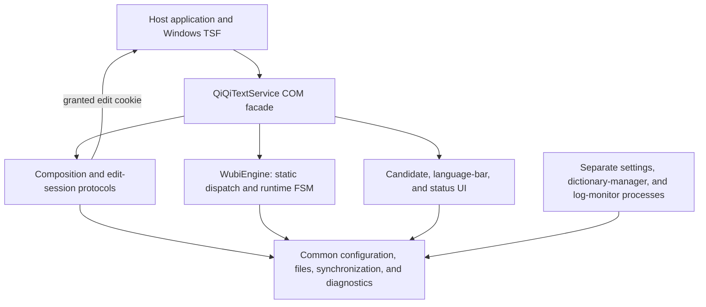
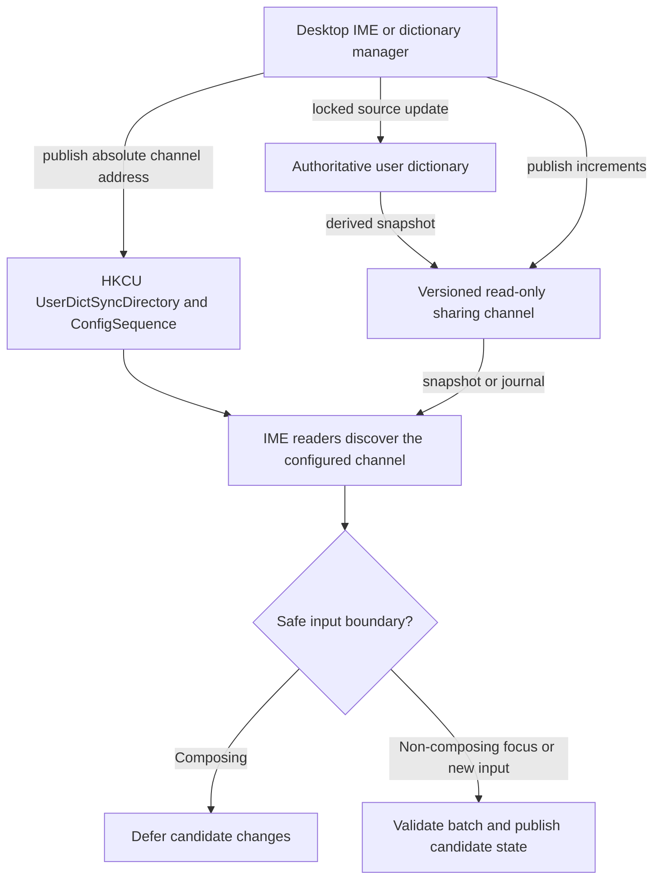

# QiQiIME Architecture

This guide describes the current Windows TSF implementation, module boundaries,
input/data flows, and remaining limitations. It is not a task execution log.
Detailed lifecycle, capture, measurement, and host evidence belong in the
[composition](composition.md), [logging](log.md), [metrics](metrics.md), and
[host](hosts.md) guides.

## 1. Runtime and Build Boundaries

QiQiIME is an in-process TSF COM DLL. Each host process owns its IME instances,
engine state, COM objects, windows, and module-scoped diagnostics. There is no
separate IME daemon or cross-process pointer sharing.

The shared code in this diagram is statically linked into each consuming binary;
it does not imply shared mutable runtime objects.

| Build target | Source | Responsibility |
| --- | --- | --- |
| `qiqi_common` | [common](../src/common) | Configuration, files/codecs, sync, ETW, RAII, theme/DPI and shared controls |
| `qiqi_engine` | [engine](../src/ime/engine), [FSM](../src/ime/fsm) | Wubi rules, lookup, candidates, user dictionaries and phrase ordering |
| `qiqiime` | [TSF](../src/ime/tsf), [composition](../src/ime/comp), [IME UI](../src/ime/ui) | COM service and actual host edits/presentation |
| `qiqi_settings_ui` | [settings](../src/tools/settings) | Shared settings window used by the EXE and in-process fallback |
| Standalone tools | [tools](../src/tools) | `QiQiIMESettings`, `QiQiIMEDictManager`, `QiQiIMELogMonitor` |

Engine tests do not require TIP registration or a COM host. The engine still
depends on Windows/common code and can perform dictionary/configuration I/O;
static-library separation is not a pure-computation or nonblocking guarantee.
Tests mirror production module boundaries. Build commands are in the
[development guide](dev.md#build-and-test).

## 2. TSF Registration and Service Lifetime

[Registration](../src/ime/tsf/register.cpp) publishes an Apartment-threaded
in-process server and a `zh-CN` language profile (`0x0804`). x64 and x86 use their
corresponding registry views; WOW64 registration preserves an existing native
profile rather than overwriting shared TSF profile state.

The service declares keyboard, UI-element, display-attribute, immersive, and
COM-less categories. Those declarations are capabilities, not real-host
certification. Secure-mode capability is not declared; registration/unregistration
also remove its legacy category. Windows login/secure-desktop support remains
outside the verified scope.

The COM facade is split by responsibility:

- [tip_service.cpp](../src/ime/tsf/tip_service.cpp): construction, activation,
  teardown, registrations, thread-manager notifications and providers.
- [tip_keys.cpp](../src/ime/tsf/tip_keys.cpp): key testing/handling, preserved keys,
  Shift tracking, and input admission.
- [tip_composition.cpp](../src/ime/tsf/tip_composition.cpp): composition/layout
  adapters, target preparation, captured edits and presentation callbacks.
- [tip_config.cpp](../src/ime/tsf/tip_config.cpp): loading/reload, compartments,
  mode observation, language-bar actions and settings launch.

Activation is cancellable. Reentrant deactivation invalidates input/UI permission
and requests cancellation without waiting. After the in-flight registration
publishes ownership, the outer activation tears down and returns `E_ABORT`.
Nested activation is rejected.
Accepted activation retains the service through guard restoration.

Composition state has a stable nonmovable owner, activation/context epochs, and
captured-object identity checks. Stale application callbacks stop, while
independent old-composition cleanup can run after local deactivation. Cleanup
preserves preedit and never edits a replacement target or restores UI.
Host write permission, local completion, and successful host cleanup are separate
results. See the [lifecycle diagrams and contracts](composition.md).

## 3. Input Processing and the FSM

### Prediction versus execution

For ordinary key-down input, deciding whether to handle a key is separate from
processing it and writing the result into the application's input field:

1. **Determine whether the IME should handle the key
   ([`OnTestKeyDown`](../src/ime/tsf/tip_keys.cpp#L208)).**
   TSF asks whether the IME intends to handle the key instead of passing it
   directly to the application. This callback does not bind an input context,
   look up candidates, advance the engine state, or request a document edit.
   If the incoming `ITfContext` is the current input context,
   [`ShouldEatKey`](../src/ime/engine/engine.cpp#L214)
   checks the current engine state. If it is a different context,
   [`ShouldEatKeyAfterReset`](../src/ime/engine/engine.cpp#L219)
   checks the state the engine would have after clearing
   the old composition. That is only a prediction: it does not actually clear
   the composition or bind the new context.

2. **Process the key ([`OnKeyDown`](../src/ime/tsf/tip_keys.cpp#L243)).**
   The actual callback first records Shift, Ctrl, Alt, and CapsLock state.
   Calls into the application can dispatch newer keyboard messages or reenter
   the service, so later processing must use the state captured for this key.
   The callback checks whether input is allowed in the target context, calls
   [`PrepareInputContext`](../src/ime/tsf/tip_composition.cpp#L123),
   and checks access again before processing the key.

3. **Use this key's result when editing the document.**
   [`WubiEngine`](../src/ime/engine/engine.h#L54) returns a
   [`KeyProcessResult`](../src/ime/engine/engine.h#L28) containing the committed text,
   composition text, candidate lists, and other presentation data for this key.
   The edit session created by
   [`ApplyEngineResult`](../src/ime/tsf/tip_composition.cpp#L148)
   owns this result snapshot even if it runs later, rather than rereading engine
   state that a subsequent key may already have changed.

Returning `TRUE` from [`OnTestKeyDown`](../src/ime/tsf/tip_keys.cpp#L208)
only indicates that the IME intends to
handle the key. It does not grant permission to change the application's text.
The actual document edit still requires a TSF-granted edit session and checks
that its captured target and lifecycle ticket remain valid.

### Static dispatch, dynamic outcomes

[FSM types](../src/ime/fsm/types.h) define seven engine states: English, Idle,
Composing1 through Composing4, and TempEnglish. Eighteen key-event categories map
to transition operations through the [shared rules](../src/ime/fsm/transitions.h).
The table chooses operation/consumption policy, not a predetermined next state.

Runtime handlers return `TransitionOutcome { next_state, result }`. The common
execution entry applies the final state once, after actual lookup/configuration
decisions. Handlers do not assign lifecycle state or predict outcomes by performing
extra lookups. Exceptions reset composition data, diagnose failure, and propagate.

Focus/context removal/deactivation are external lifecycle events, not added key
categories. Reset and prediction share `StateAfterCompositionReset`: Chinese
composition returns to Idle, English remains English, and width/punctuation survive.

Candidate clicks call `CommitCandidate` directly, not simulated digit keys.
Ordinary digit selection shares its commit logic. Temporary English digits append
text; candidate clicks commit the temporary text without adding a candidate number.
Shift taps use [ShiftTapTracker](../src/ime/tsf/shift_tap.h), outside the Wubi FSM:
the 350 ms deadline, original press time, modifiers/mouse cancellation, and
test/actual release checks are shared.

### Host effects and restrictions

Inside a TSF-granted session, the facade starts/updates composition, applies text
and display attributes, commits/cancels, and positions candidate UI. Ticket and
composition identity checks protect reentrant boundaries. Same-context old
cleanup forces new writes to queue; execution rechecks that barrier without
processing a key twice.

[ContextFacts and AccessPolicy](../src/ime/comp/access_policy.h) apply across
keyboard, preserved keys, candidate actions, mode changes, and queued edit/layout
work. Recognized password/PIN targets temporarily use English and restore the
previous mode; private scopes permit input but suppress learning/persistence.
Unknown optional signals do not certify safety. See
[restricted-input behavior](restricted.md) for contracts and host limits.

## 4. Dictionaries and Candidate Ordering

The engine combines selected bundled/custom primary dictionaries, optional
extensions, user entries, and an embedded fallback. Default ordering remains
predictable; optional phrase promotion is based on recent explicit selection,
not an accumulated usage-count ranking. Single-character candidates are not
dynamically promoted.

Pinned entries take priority over optional dynamic phrase order and ordinary
dictionary results. Suppression applies across sources. User-file rules preserve
ordinary entries, `^` pins, and `!` suppressed entries; suppressed entries are
not compiled as positive candidates.

### Loading and validation

[Binary dictionary loading](../src/ime/engine/binary_dict.h) supports UTF-8 text,
the supported Rime-style YAML subset, and `.qdict`. Validation distinguishes
invalid encoding, malformed binary data, invalid rows, and empty usable content.
It is not a full YAML parser or proof of Wubi-code semantics.

Custom text dictionaries compile in memory. Explicit custom `.qdict` files are
validated directly: an old cache must not conceal a missing/corrupt chosen source.
Runtime failure preserves the active primary dictionary; first-use failure can
fall back to the bundled default. Tools and the IME share the load plan/validation,
while source/path resolution and actual effects stay in their adapters.

Bundled dictionaries can use adjacent or local compiled caches. Cache validity
checks format and source metadata; cache creation still needs access and can fail.
Read-only mappings use anonymous mapping objects and file-sharing rules that
permit compatible replacement, not arbitrary concurrent in-place writes.
Existing views can retain old file data until a checked reload.

Mapped pages can be shared, but per-process objects and allocations remain.
Compiled user dictionaries contain personal phrases; mapping anonymity is not
encryption or an access-control bypass. Temporary-file replacement and registry
transactions do not form a cross-resource transaction.

### Authoritative files and synchronization

The user dictionary file is authoritative. [change_sync](../src/common/change_sync.h)
coordinates file locks, expected versions, bounded journals, baseline identities,
and snapshot recovery. Directory notifications are wakeups, not authoritative
state or guaranteed delivery.

Desktop writers publish `UserDictSyncDirectory` transactionally.
AppContainer readers use that absolute address rather than their own
`LOCALAPPDATA` or the private source file. Explicitly empty publication means no
shared user dictionary; invalid/inaccessible publication is a diagnosed failure.
Source content, compiled caches, and channel files are not atomically committed
as one resource.

Version gaps, expired records, and baseline changes require snapshot recovery.
External source edits can produce bounded increments when order is preserved;
large replacement/reordering establishes a new baseline. Failed batch application
must not publish partially applied candidate state or advance a successful version.
Configuration/dictionary updates do not promise immediate cross-process visibility.

Phrase ordering uses checksummed `QPF1` storage, with legacy text reading retained.
Desktop processes coordinate writes; AppContainer processes remain read-only.
Apply dictionary/ordering updates at safe focus/new-input boundaries, not in the
middle of composition.

## 5. Configuration and Runtime State

| Scope | Examples and mechanism |
| --- | --- |
| Per-user persistent configuration | Dictionary choices, input defaults, UI language, visibility, sounds; `HKCU\Software\QiQiIME` |
| TSF thread/session mode | Open/close, width and punctuation through system compartments |
| Current input | Preedit, candidates, page/selection, target and epochs; not global configuration |
| Shared transient UI state | Status-bar coordinates through a dedicated global compartment |

Typed member descriptors share registry/backup keys and value constraints;
settings use their editable-field projection. Configuration defaults do not
overwrite another live session's current mode.

Save configuration before notifying instances. `ConfigSequence` and TSF global
compartments prompt reload; focus checks compensate for missed notifications.
System mode compartments are also observed in the reverse direction to update
the engine and UI. These signals are not durable dictionary-change journals.

Settings failures retain edits and report the real error. Notification failure
reports "saved but not propagated" rather than rolling back a completed save.
Open settings merge external field changes without discarding local unsaved edits.
The shared settings window owns its single-instance mutex; EXE/IME callers do not
pre-create it.

## 6. UI and Standalone Tools

Candidate presentation negotiates `ITfUIElementMgr::BeginUIElement`.
`show_own_ui=true` permits the nonactivating popup; false supplies candidate data
for host rendering instead. UILess is not limited to games and is not a guarantee
that every game accepts the IME.

Capture the old manager when retiring an element ID. A reentrant replacement can
reuse its numeric ID; old teardown must not end newer UI. Disabled presentation
prevents retained UI interfaces from reopening inactive windows. Native destruction
is owner-thread work, with `WM_NCDESTROY` clearing matching handles.

Layout uses TSF text extents, guarded layout notifications, and existing GUI/cursor
fallback. Real screen coordinates are not scaled twice; synthetic geometry uses
monitor DPI. Preserve work-area clamping, negative monitor coordinates, theme/high
contrast behavior, and raw TSF rectangles unless an intentional change is tested.

Candidate text uses Direct2D/DirectWrite with the existing GDI fallback. Rare
characters and color glyphs depend on installed fonts/platform support.
Status icons/tooltips and settings controls share common RAII/theme/DPI helpers.
Parent-owned controls and borrowed drawing/subclass contexts retain their explicit
lifetime rules; numerical constants with different meanings are not merged.

| Tool | Current role |
| --- | --- |
| Settings | Configuration drafts, validated save, live merge, theme/language preview |
| Dictionary manager | Search/code lookup, entries/pins/suppression, phrase ordering, import/export, local backup/restore |
| Log monitor | Ordinary ETW events, Metrics and own diagnostics views, filtered export |

Tools reuse window/dialog/control helpers while retaining their own models and
commands. Dictionary editing has explicit browse/new/edit draft states; failed
save preserves the draft and does not revive an externally deleted entry.
Backup restore separates validation/planning from per-resource writes and reports
partial success/failure; it does not promise global rollback.

Modal loops preserve `WM_QUIT`, owner enable state, and cancellation/error
distinctions. Clipboard backoff is bounded at suitable high-level copy/read
boundaries; it does not make low-level clipboard ownership blocking or infallible.

## 7. Diagnostics and Access Boundaries

Production diagnostics are ETW and debugger output, not an automatically written
text log. Initialize the provider outside `DllMain`; it is module-scoped and
survives individual service deactivation. Queries/writes do not implicitly
register it. Preserve actual HRESULT/Win32 domains; queue acceptance and callback
exit are not host-operation success.

Metrics use a separate explicit keyword subscription, independent of ordinary
log level. Typed protocol, bounded aggregation, Metrics view, and JSON export are
implemented; production samples currently cover three focus segments only.
Broader instrumentation and full overhead acceptance remain incomplete.
See [capture](log.md) and [measurement semantics](metrics.md).

The DLL inherits host permissions. Registration/shared data can grant read access
to the two application-package groups, not individual application identities;
qualifying other apps may read exposed settings/phrases. No sandbox bypass or
blanket profile access is provided. See [AppContainer](uwp.md) and
[privacy](../PRIVACY.md).

Do not emit input text, clipboard data, candidate phrases, key sequences, or raw
object addresses. Diagnostic exports and dumps still require review/redaction.
Controlled tests are not universal host certification.

## 8. Compatibility and Remaining Work

### Explorer file-list positioning

Reported Explorer file-list input can place both the composition window and
QiQiIME candidate popup near the screen's top-left. Recorded layout callbacks
ran and TSF returned top-left text extents, explaining why the candidate followed
those coordinates. This does not establish why TSF supplied them or who owns
every visible composition window.

The current behavior is retained: no Explorer-specific bypass or disabled
file-list input. Zero-height rectangle handling alone is not a complete fix;
any change must validate the composition window and candidate popup separately.
[Historical observations](https://github.com/cloudfyy/qiqiime/blob/v1.0.7/docs/arch.md#已知兼容性问题explorer-文件列表输入定位)
and [position diagnostics](log.md#candidate-positioning) preserve the evidence.

### Validation boundary

User feedback closes the earlier lifecycle/host tasks, not every application's
version/scenario matrix. Historical caret-offset, positioning, and intermittent
hang reports are not thereby root-caused. Preserve observed failures and use
specific new evidence for follow-up; do not reopen completed refactors merely to
add another coordinator. Current test entry points are in
[development](dev.md#focused-tests) and [composition validation](composition.md#9-validation-and-remaining-boundaries).

### Unimplemented or evaluation-only extensions

The following remain separate from current behavior; this is not a release
commitment or a dated execution order:

| Area | Remaining scope |
| --- | --- |
| Metrics | Key/candidate/commit/cleanup instrumentation, controlled realtime/cross-process overhead, optional resource/trend sampling |
| Shortcut and ranking options | User-editable hotkeys/punctuation and additional candidate ordering policies, preserving fixed-order defaults |
| Pinyin assistance | Temporary pinyin, pinyin-assisted lookup/radical aids; full mixed/pinyin modes require separate product evaluation |
| Character selection | Simplified/traditional conversion, character-set/single-character filters |
| Convenience input | Dedicated phrase/templates, symbol panel, additional appearance controls |
| Learning and coding schemes | Smart continuous phrase learning and Wubi 98/other schemes with explicit data/rule isolation |
| Cross-device/optional tools | Authorized conflict-aware device sync, optional skins/tools; local cross-process sync is already implemented |
| Login/secure desktop | Separate contract/design/VM recovery validation; capability flags alone cannot establish support |

## Further Reading

- [Composition lifecycle](composition.md): tickets, captured cleanup, reentrancy, UI and notification diagrams.
- [Restricted input](restricted.md): recognized password/PIN and private-scope behavior.
- [AppContainer](uwp.md): actual token, access and synchronization constraints.
- [Logging](log.md) and [metrics](metrics.md): capture, protocol, export and measurement limits.
- [Development](dev.md): build/test/quality/release workflow.
- [Installation](install.md): MSI and registered ZIP deployment; the ZIP is not an unregistered portable IME.
- [Release notes](release-notes.md) and [host evidence](hosts.md): historical changes and observed compatibility.
