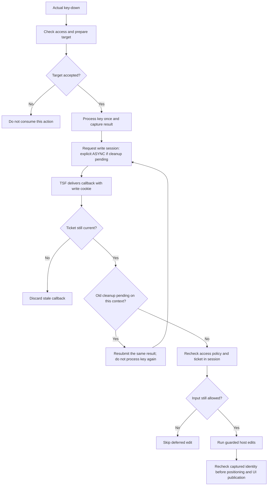
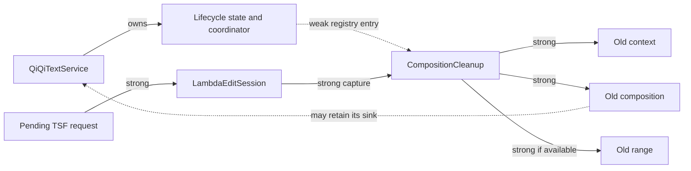
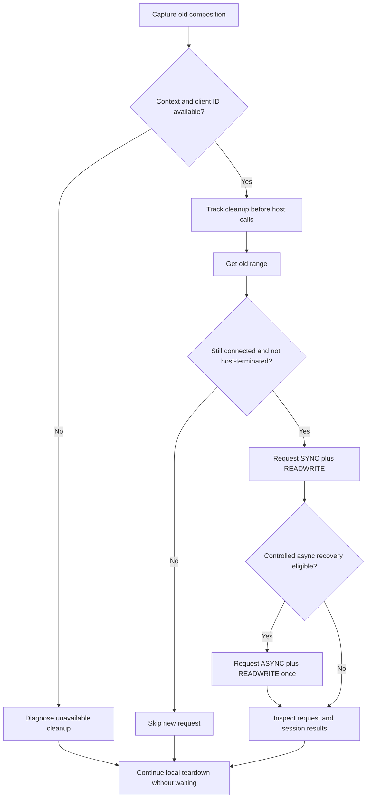
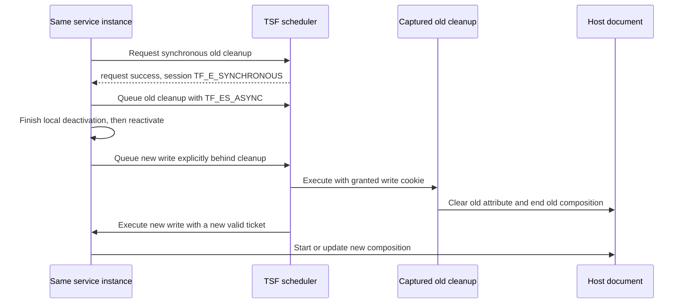
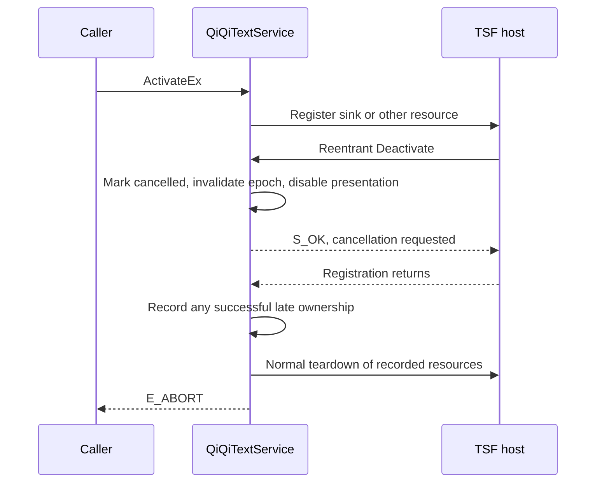
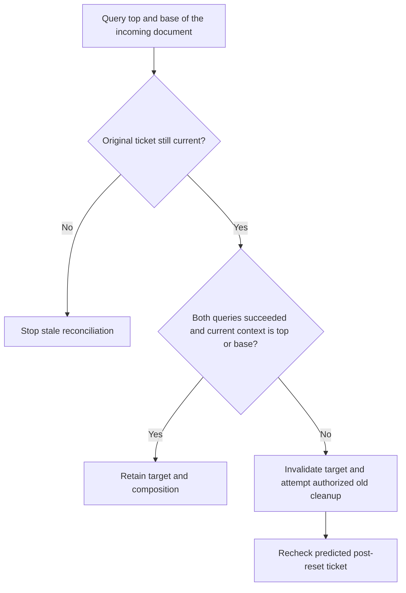

# TSF Composition Lifecycle

This guide describes the current composition, edit-session, cleanup, and UI
contracts. The diagrams show control flow and ownership, not additional threads
or a proposed coordinator. Use the [logging guide](log.md) for capture and the
[development guide](dev.md#tsf-hang-diagnostics) for tests and hang diagnostics.

## Current Module Map

| Surface | Implementation | Responsibility |
| --- | --- | --- |
| COM service | [service](../src/ime/svc/service.cpp), [keys](../src/ime/svc/keys.cpp), [input coordinator](../src/ime/svc/key_handler.cpp), [context access](../src/ime/svc/context_access.cpp), [configuration](../src/ime/svc/config.cpp), [composition facade](../src/ime/svc/composition.cpp) | COM identity, activation/focus, registration, entry gates, actual engine/UI effects |
| State and reset | [state.h](../src/ime/comp/state.h) | Epochs, active/reset flags, current composition/context/document, cleanup coordinator |
| Input target | [target.h](../src/ime/comp/target.h), [access_policy.h](../src/ime/comp/access_policy.h) | Target preparation, document identity/reconciliation, restricted-input facts and policy |
| Application edits | [edit.h](../src/ime/comp/edit.h), [edit_session.h](../src/ime/tsf/edit_session.h) | Immutable result snapshots, tickets, request/execution gates, activity scopes |
| Start/update/finish | [start.h](../src/ime/comp/start.h), [update.h](../src/ime/comp/update.h), [finish.h](../src/ime/comp/finish.h) | Host-call order, publication, commit/cancel, termination routing |
| Text and attributes | [range.h](../src/ime/comp/range.h), [attribute.h](../src/ime/comp/attribute.h) | Guarded range/text/selection and display-attribute operations |
| Old-composition cleanup | [cleanup.h](../src/ime/comp/cleanup.h), [cleanup.cpp](../src/ime/comp/cleanup.cpp) | Independent captured ownership, weak registry, recovery and removal barriers |
| Presentation/layout | [presentation.h](../src/ime/comp/presentation.h), [layout.h](../src/ime/comp/layout.h), [native UI](../src/ime/ui) | UI registration/withdrawal, guarded positioning, actual window resources |

The service deliberately retains activation/deactivation, focus/configuration,
and real engine/window effects. Synchronous helpers borrow callbacks and state;
they do not retain edit cookies or introduce a universal event queue.

## 1. Two Separate Problems

| Work | Required behavior after invalidation |
| --- | --- |
| Application update, commit, cancel, or layout callback | Reject stale work; do not modify a replacement target or UI |
| Independent cleanup of an old composition | May still execute after deactivation, using only captured old objects |

A strong COM reference prevents destruction, not stale execution. Releasing
`ITfComposition` locally does not call `EndComposition` or remove the host's
`GUID_PROP_COMPOSING`. Cleanup needs a valid write cookie to clear
`GUID_PROP_ATTRIBUTE` and end that composition, or a host termination notification.

Focus-loss/deactivation cleanup **preserves preedit text**. It does not commit a
candidate, delete text, recreate a composition, or restore UI. `Deactivate`
returns synchronously while host cleanup can remain queued.

## 2. Application Edit-Session Barrier

`CompositionLifecycleState` is noncopyable/nonmovable and stays at the same
address for the service lifetime. Preserve member order
`composition, cleanups, context, document`: reverse destruction releases document,
context, cleanup bookkeeping, then composition.

| Check | Why it matters |
| --- | --- |
| Active and not resetting | A live service can still be inside teardown |
| Activation epoch | Reactivating the same instance must not revive old requests |
| Context epoch | An A-to-B-to-A switch must not revive old requests |
| Captured target | Work belongs to its original context |
| Captured composition identity, where applicable | Same-context, same-epoch replacement is still a different composition |

An edit ticket contains both epochs and the target. Epochs are not per-key
sequence numbers: valid writes in one epoch retain normal FIFO behavior.
Check the ticket before inspecting pending cleanup. Expected stale rejection
returns `S_OK` with a skip diagnostic, not a fabricated host-edit success.

### Edit admission and execution

The diagram assumes TSF delivers the request. Rejection or abandonment does not
enter the callback and must not be presented as successful editing.
`CompositionEditTask` owns its context, immutable `KeyProcessResult`, ticket,
and activity. Deferred service callbacks retain the service separately; the task
itself owns neither a service nor an edit cookie.

### Reset and preparation

Invalidate the context epoch before teardown can reenter. Every
`CompositionContextResetScope` entry advances it, including nested attempts.
Only the outer entered scope performs cleanup/local teardown and clears the reset
flag on exit. A nested reset invalidates work without repeating teardown.

For a new input target, retain its pending context, reset the old target, query
its parent, publish the new context/document, and connect subscriptions.
Check the predicted ticket after reset and after reentrant host calls. Withdraw
a subscription published after invalidation. A Pop of the pending context must
cancel preparation even before the context is published.

Missing parent/layout information has its diagnosed existing nonfatal policy;
it does not fabricate a relationship or grant write access. The actual session
request still determines access.

### 2.1 In-Flight Host Calls

Range lookup, text/selection changes, property calls, and termination can reenter
the service. Retain the original composition and recheck epoch/target/composition
at the existing operation boundaries. A successful entry check is insufficient.
These checks cannot undo a host call that has already started.

Update returns the captured composition so subsequent positioning and publication
use the same identity. A null expected composition can match an empty slot;
do not add a blanket non-null requirement.

Commit clears attributes, writes committed text, collapses the caret, and ends
the composition. Cancel clears preedit text and ends it without the commit
attribute/selection sequence. Ordinary range/attribute/text failures remain
diagnosed best-effort paths when identity is current; invalidation stops later work.

Before calling captured `EndComposition`, detach the old shared composition and
retire its caret state. Do not write shared state after the call: a reentrant
replacement must survive even if ending the old composition fails.
Direct insertion with no composition uses the existing insertion interface;
empty text is a no-op and must not create a composition.

### 2.2 Keyboard Event State

Test/actual key-down snapshots modifiers, CapsLock, and relevant mouse-button
state before compartment queries or target preparation. Host calls can pump newer
messages; newer state belongs to the next event, not the current one.

Test-key prediction remains read-only. A new target uses the shared reset preview,
not a live engine reset. Actual key-down must still prepare and validate its target.

## 3. Cleanup State and Strong/Weak Ownership

Handoff detaches the current composition into an independent record containing
the old context/composition/range and diagnostics. Register that record before
range lookup or session requests: both can reenter.

The cleanup callback captures the record, not the service, manager, or new target.
The registry is weak to avoid a service-owned cleanup cycle. The composition can
still retain its service sink; deactivation need not destroy the service.
RAII releases captured resources when execution finishes or TSF abandons the request.

| Record flag | Meaning, not a success claim |
| --- | --- |
| `started` | Cleanup callback entered |
| `attribute_clear_started` | Actual property `Clear` began; prevents duplicate clearing |
| `finished` | Callback exited, termination handled unstarted work, removal invalidated it, or request failed |
| `terminated` | Host reported old-composition termination; do not end it again |
| `async_requested` | Recovery was attempted, not necessarily accepted/executed |
| `context_removed` | No further edits are permitted on the captured removed target |

Expired/finished records are pruned when queried. `tracked_cleanups` is a weak
container slot count, not the number of pending or successful requests.
`released` is emitted before member COM references are destroyed.

### Unpublished composition starts

`StartComposition` uses a temporary record with `id == 0`, registered before the
host call. It is not a scheduled cleanup and consumes no cleanup diagnostic ID.
Removal/termination can invalidate the result before the host call returns.

Publish only a successful, non-null, current, connected, unterminated result.
Hand a stale but still-live connected result to independent cleanup, including
a stale non-null result returned with a failure HRESULT. Do not publish it over
a replacement. Current failed starts retain their existing discard policy;
discard does not certify termination.

Keep preparation interfaces/range and the starting record alive through result
resolution. Resolution can itself reenter while scheduling old cleanup.

## 4. Deactivation Algorithm and Request Results

Normal deactivation marks application state inactive, disables presentation, and
advances the activation epoch before handing off the old composition. Cleanup
tries synchronous write access first and never blocks the message pump.

Recovery is eligible **only** when the outer request succeeded, `session_hr` is
`TF_E_SYNCHRONOUS`, the callback has not started, the host has not terminated the
composition, and the context has not been removed. Other failures do not trigger
unbounded retries or an attempt to bypass read-only access.

| `request_hr` | `session_hr` | Interpretation |
| --- | --- | --- |
| Success | Callback result | It may already have run synchronously; inspect individual operations |
| Success | `TF_E_SYNCHRONOUS` | Try controlled recovery only under the conditions above |
| Success | `TF_S_ASYNC` | Queued, not completed |
| Failure | Any value | Request failed; initialized inner output proves no execution |
| Success | `TS_E_READONLY` or another failure | Diagnose the actual failure; no generic async bypass |

The callback clears the old display attribute, then ends the old composition.
Range/attribute failure does not prevent best-effort termination unless removal
or host termination invalidates it. Thus termination can succeed while an
attribute remains. With no range, there is no attribute-clear call.

Local teardown resets state/UI, unadvises subscriptions, releases the original
thread manager/client state, and clears external dictionaries without waiting
for queued cleanup. A host can abandon a request or deny a write lock.
`Deactivate == S_OK`, callback exit, and `finished` do not certify host cleanup.

### 4.1 Native Windows and Retained UI Objects

Disable presentation before teardown. Retire the candidate element ID, destroy
the candidate popup, status tooltip, and status bar on their owning thread, then
release TSF registrations. Native failure retains the handle for a possible
owner-thread retry while the remaining TSF teardown continues.

`WM_NCDESTROY` clears only the matching stored handle. Wrong-thread destruction
is rejected with real diagnostics; final destruction is not marshalled to an
arbitrary thread. `Deactivate` returns `E_FAIL` on native window-destruction
failure, separately from host composition/UI-element results.

Retained UI objects stay allocated for reactivation but cannot reopen inactive
windows: candidate `Show(TRUE)` returns `S_FALSE` and `IsShown` reports false
while presentation is disabled. Final service destruction disconnects callbacks
capturing the service. Independent cleanup cannot recreate UI.

## 5. Key Execution Sequences

### 5.1 Synchronous Success

A synchronous cleanup callback enters before `RequestEditSession` returns.
Attribute clearing, `EndComposition`, and host termination notifications can
interleave. Do not require `sync-result` to precede `callback-enter`.

### 5.2 Synchronous Rejection and Asynchronous Recovery

An accepted recovery request can execute after local deactivation returns.
`released(started=false, finished=false)` means neither execution nor termination
handling was observed before record release, not successful cleanup.
Capture/request evidence is needed to distinguish rejection from abandonment.

### 5.3 Immediate Reactivation on the Same Context

`TF_ES_ASYNCDONTCARE` is zero and permits synchronous execution. A new synchronous
write can overtake an old queued cleanup, so explicitly queue new writes behind
matching unfinished cleanup. Other contexts are unaffected.

This sequence assumes accepted asynchronous FIFO scheduling, a current new ticket,
and no intervening removal/termination. If reactivation occurs inside an
outstanding `StartComposition`, a new callback can precede the late cleanup.
The execution-side check requeues the **same snapshot** behind it; it does not
process the key again or advance the FSM.

### 5.4 Early Host Termination of the Old Composition

Route notifications through cleanup bookkeeping before current application state:

| Identity/state | Action |
| --- | --- |
| Old queued cleanup | Mark terminated; clear the old attribute with the notification cookie if clearing has not started; mark unstarted work finished |
| Cleanup executing inside property lookup | Clear once with the notification cookie; the outer call skips its now-stale clear/end |
| Cleanup already inside actual `Clear` | Do not clear again; skip subsequent end after termination |
| Current composition | Detach it, clear its attribute, then reset only if ticket and expected empty slot still match |
| Unpublished start | Mark terminated; never publish or explicitly end the late result |
| Unrelated old composition | Ignore; never reset a replacement |

Duplicate notifications do not repeat clearing. The notification supplies the
cookie; do not request another edit session or end an already-terminated object.
Current-termination attribute failures are diagnosed but do not suppress an
otherwise still-current local reset.

## 6. Reentrancy Rules

### Activation cancellation

Do not dismantle a registration before its in-flight call publishes ownership.

Accepted activation retains the service until activity/transition guards unwind.
Repeated cancellation is idempotent. Cancellation stops later setup and
compartment writes; failures retain their own HRESULTs alongside `E_ABORT`.

- Nested activation during activation/deactivation/reset/preparation returns
  `E_UNEXPECTED`. Missing manager returns `E_INVALIDARG`; required-sink failure
  follows the diagnosed rollback path and returns `E_FAIL`.
- Reentrant deactivation during deactivation returns `S_OK` without repeating
  resource transfer or teardown.
- Reset and preparation reject reentrant input. The outer reset flag spans COM
  release, subscriptions, cleanup, and UI work.
- RAII restores activity/transition flags on early and exceptional exits.
  Internal helper exceptions are not converted to successful work.
- Focus revision prevents older reentrant focus processing from overriding newer
  focus state. Context removal alone must not suppress focus-loss hiding.
- Never wait for queued cleanup, add a worker thread to perform TSF edits, or
  retain a granted cookie beyond its session.

### 6.1 Candidate UI Registration and Withdrawal

| Operation | Required publication/ownership rule |
| --- | --- |
| Begin | Capture the manager, negotiate host display permission, then check the original ticket before publishing its returned ID |
| Late stale Begin | End a valid successful provisional ID through the captured old manager, never a replacement manager |
| End | Capture the old manager, invalidate the shared ID and hide UI before calling the host; perform no shared reset afterward |
| Manager/Begin failure | Preserve diagnostics and existing popup fallback, still gated by presentation permission |

Different managers can reuse numeric element IDs. Matching a number is not
matching ownership. Reentrant Begin/End must not deregister or hide newer UI.
Respect the host's `show_own_ui`/UILess decision; failed registration is not proof
that a host element exists.

### 6.2 Layout and Positioning

A deferred layout task owns its context, optional notification view, ticket,
and activity, but not a composition. On execution, query the current composition
for that still-valid epoch, retain it through positioning, and reject replacement
between view/range/extent calls. A supplied notification view takes precedence.

Read sessions use `TF_ES_ASYNCDONTCARE | TF_ES_READ`; no cleanup-write barrier or
new queue is introduced. Access is rechecked in the callback. `OnLayoutChange`
returning `S_OK` does not certify successful query or movement.

Discard stale rectangles even when the query succeeded. Preserve raw TSF
coordinates, clipping, and zero/inverted rectangles; do not add normalization
as an undocumented lifecycle change. Real screen coordinates are not DPI-scaled
again; synthetic GUI/cursor fallback geometry is.

Successful TSF positioning sets caret validity before movement. Fallback is
attempted only without a valid prior caret; successful fallback does not
automatically set that flag. Window movement remains a service/UI effect.
See [position diagnostics](log.md#candidate-positioning) for real-host analysis.

## 7. Log Protocol and Troubleshooting

Lifecycle records use the ordinary TraceLogging `message` string; they are not
typed Metrics fields. ETW headers supply PID/TID/time/level and activity metadata.
Capture Verbose for detailed stages; application Off suppresses ordinary events.

- `TsfLifecycle(service=..., stage=...)` tracks activation, reset, ordinary
  termination, and stale application work.
- `TsfCleanup(service=..., cleanup=..., stage=...)` tracks one independent cleanup.
- Correlate **PID + module-load lifetime + service + cleanup** and activities.
  Numeric IDs can restart after module reload.
- Epochs before/after reset are not pointers. In stale diagnostics, values before
  the slash are captured and after it are current.
- A cleanup's creation epoch can be the invalidated deactivation epoch, not the
  original input request's epoch. IDs do not grant execution permission.

| Cleanup stages | What to inspect |
| --- | --- |
| `created`, `unavailable`, `get-range` | Captured objects and real acquisition results |
| `sync-request`, `sync-result` | Flags, both HRESULTs, callback/termination state |
| `async-request`, `async-result` | Recovery attempt and queue acceptance, not completion |
| `sync-failed-no-fallback`, `async-rejected` | Decisive failure and why no recovery completed |
| `callback-enter`, `callback-exit` | Actual callback lifetime, not host-operation success |
| `attribute-clear`, `end-composition` | Independent API results; either can fail |
| `host-terminated`, `host-attribute-clear` | Host-cookie handling and duplicate suppression |
| `skip-host-terminated`, `skip-end-after-host-termination` | Prevention of duplicate termination |
| `write-forced-async` | Pending old cleanup forced an application write to queue |
| `context-removed`, `skip-removed-context`, `skip-end-after-context-removal` | Removal forbids remaining edits |
| `skip-request-invalidated` | Range lookup invalidated cleanup before a request |
| `released` | Pre-member-destruction snapshot, not complete destruction or cleanup |

Important lifecycle stages include `stale-edit-skipped`,
`replaced-composition-edit-skipped`, `composition-start-write-deferred`,
`composition-start-terminated`, `composition-start-removed`,
`stale-composition-start`, `write-requeued-behind-cleanup`, `ui-begin-stale`,
`ui-end`, and `ui-windows-destroyed`.

When troubleshooting:

1. **Queued but no entry:** inspect capture loss/filtering, request results,
   message pumping, and release state. Missing events prove neither success nor leak.
2. **Attributes remain:** inspect range, attribute clear, and end independently;
   callback exit is insufficient.
3. **Replacement text/UI is damaged:** compare epochs/composition identity,
   forced-async/requeue stages, old cleanup, and captured UI-manager ownership.
4. **Fresh input is skipped:** locate the invalidating reset/removal/deactivation
   and compare captured/current tickets.

Preserve real HRESULT/Win32 domains and both request/session results.
`S_FALSE`/`TF_S_ASYNC` are not failures or completion guarantees.
Do not record input, key values, candidates, range text, or raw COM addresses.

## 8. Document and Context Notifications

### 8.1 Context Is Still the Input Identity

The current context is the input target; its cached parent is not a document
registry or focus history. Retaining the parent permits uninitialization matching
after the disconnected context's parent query fails. Document matching uses an
interface-pointer fast path, then canonical `IUnknown` identity.

`OnInitDocumentMgr` owns no document-wide resources and remains a no-op.
Notifications do not proactively bind a target; actual input prepares it.

### 8.2 Reconciling Focus and Stack Changes

For document-target reconciliation, retain the original context and ticket,
query both `GetTop` and `GetBase`, diagnose both results, then recheck:

A main/base context covered by a modal top context remains valid. Preservation
does not authorize processing a key for that modal target. An actual key for a
different context still uses explicit preparation.

Related Push notifications use this reconciliation; unrelated documents are
ignored. Pop compares the removed context itself: unrelated/modal Pop does not
reset the main target. Uninitialization matches its cached parent. Repeated
notifications become harmless after the relationship has been cleared.

### 8.3 Reset Before Processing a New Target's Key

Prepare the new target **before** interpreting its key. Reset the old engine and
invalidate its work, arrange connected-target cleanup, then bind/check the new
context and subscriptions. Do not commit the old target's raw code into the new
target. A fresh-target Backspace must not operate on the previous composition.

Reset preview and actual reset share engine classification: composing Chinese
states become Idle, English remains English, and width/punctuation are retained.
Deferred host cleanup must not keep the new target's FSM composing.

For ordinary user-requested Chinese-to-English switches,
`CommitOnEnglishSwitch` defaults to true: commit raw preedit literally, including
the temporary-English `z` guide, without selecting a Chinese candidate.
False cancels only current preedit. Both switch the engine to English before
submitting captured host work, preventing reentrant resubmission. Escape and
temporary-English Space/Enter retain their own rules.

This option is not focus-loss/deactivation cleanup policy. Restricted-target
handling follows the implemented [access policy](restricted.md), including
password/PIN temporary English and private-scope persistence suppression.
Epoch checks do not replace access checks, and neither guarantees recognition
of every custom control.

### 8.4 Removal Is Not a New Write Opportunity

Current Pop/uninitialization resets with `try_host_cleanup=false`: invalidate
callbacks, release local relationships, detach subscriptions, and end candidate
UI **without requesting a new edit session**. Local release is not successful
host termination.

Mark matching cleanup records removed/finished. Previously accepted callbacks
can still arrive but must skip edits. Removal during attribute clearing prevents
the subsequent end call; old termination cannot reset a newly bound composition.

### 8.5 Additional Diagnostic Fields

`document-target` reports focus/push source, retention, and modal coverage.
`document-uninit`/`context-push` identify related parents; `context-pop` separates
current and pending preparation targets. `context-reset` records cleanup policy,
and `cleanup-skipped-removed-context` distinguishes local release from host work.
`input-document-unavailable` retains the real parent-query HRESULT.

## 9. Validation and Remaining Boundaries

Run both architectures' `QiQiCompositionLifecycleTest` and `QiQiTsfUiTest`
sequentially using the [development commands](dev.md#focused-tests).
The focused lifecycle suite excludes standalone UI suites; it supplements,
not replaces, the full TSF/UI test.

Assert actual text, property state, composition identity, subscriptions,
UI-manager/element ownership, API ordering, and COM reference recovery.
Return codes or formatted logs alone are insufficient.

### 9.1 Regression Inventory

| Contract | Representative existing tests |
| --- | --- |
| Epoch/reset ownership and nesting | [state](../tests/ime/comp/state.cpp), [context reset](../tests/ime/comp/context_reset.cpp) |
| Immutable snapshots, request flags, requeue and activity scopes | [edit execution](../tests/ime/comp/edit_execution.cpp), [requests](../tests/ime/comp/edit.cpp), [service deferred work](../tests/ime/svc/deferred.cpp) |
| New-target preparation, parent identity, modal/removal reentrancy | [target](../tests/ime/comp/target.cpp), [service target](../tests/ime/svc/target.cpp), [native documents](../tests/ime/svc/native.cpp) |
| Late starts, same-epoch replacement, commit/cancel and termination | [start/update](../tests/ime/comp/start_update.cpp), [finish state](../tests/ime/comp/finish_state.cpp), [termination routing](../tests/ime/comp/termination_route.cpp), [service reentrancy](../tests/ime/svc/reentrancy.cpp) |
| Captured cleanup, failure/removal, abandonment and owner release | [handoff](../tests/ime/comp/cleanup_handoff.cpp), [service lifecycle](../tests/ime/svc/lifecycle.cpp) |
| Retained windows and old/new manager isolation | [presentation](../tests/ime/comp/presentation.cpp), [service presentation](../tests/ime/svc/presentation.cpp), [service windows](../tests/ime/svc/windows.cpp) |
| Layout lifetime, stale rectangles and DPI routing | [layout](../tests/ime/comp/layout.cpp), [position](../tests/ime/comp/layout_position.cpp), [service layout](../tests/ime/svc/layout.cpp) |
| Access policy and restricted-target transitions | [restricted input](../tests/ime/tsf/restricted_input.cpp) |

Mocks provide deterministic failures and reentrant boundaries, not evidence that
every real host behaves that way. Private native TSF documents validate actual
API lock/notification behavior without activating the system TIP.
Debugger/ETW tests validate diagnostics separately from functional results.

[Real-host feedback](hosts.md#12-2026-11-07-用户确认任务-47-与-r05-完成)
reports normal operation and closes the prior R05/host task. It does not supply
every host/version/scenario result or establish the root cause of historical
caret, positioning, or intermittent-hang reports. Retain those evidence boundaries
without treating old task checkboxes as current implementation status.
Read-only, disconnected, abandoned, or rejected edits can still prevent full host
cleanup. No universal browser/UWP or arbitrary-thread destruction guarantee is made.

## 10. Official References

- [ITfContext::RequestEditSession](https://learn.microsoft.com/en-us/windows/win32/api/msctf/nf-msctf-itfcontext-requesteditsession): flags, locks, and two-layer results.
- [ITfComposition::EndComposition](https://learn.microsoft.com/en-us/windows/win32/api/msctf/nf-msctf-itfcomposition-endcomposition): granted write cookies and termination.
- [ITfTextInputProcessor::Deactivate](https://learn.microsoft.com/en-us/windows/win32/api/msctf/nf-msctf-itftextinputprocessor-deactivate): thread-manager reference release.
- [ITfCompositionSink::OnCompositionTerminated](https://learn.microsoft.com/en-us/windows/win32/api/msctf/nf-msctf-itfcompositionsink-oncompositionterminated): host termination notifications.
- [ITfDocumentMgr::Push](https://learn.microsoft.com/en-us/windows/win32/api/msctf/nf-msctf-itfdocumentmgr-push) and [Pop](https://learn.microsoft.com/en-us/windows/win32/api/msctf/nf-msctf-itfdocumentmgr-pop): primary/modal contexts and removal constraints.
- [ITfThreadMgrEventSink::OnSetFocus](https://learn.microsoft.com/en-us/windows/win32/api/msctf/nf-msctf-itfthreadmgreventsink-onsetfocus): document focus notifications.
