# 二十一套皮肤的完整明暗配置 / Complete Skin Palettes

设计数据；每套含 Light / Dark 两份，所有字段显式给出。`QiQiSkinTest`
会将稳定标识、双语名称、顺序及全部 546 个颜色字段与 C++ 内置目录、
注册表模板逐项核对。
注册表模板见 [ime-skins.reg](ime-skins.reg)；存储契约与界面范围见[设计文档](ime-skins.md)。

图例每列为一个明暗变体：首屏（上一页禁用）、末屏（下一页禁用）、无候选（不显示翻页按钮）。均为虚构文本，不是运行截图。

## A01 流萤 / Firefly Glow

稳定标识：`firefly`。
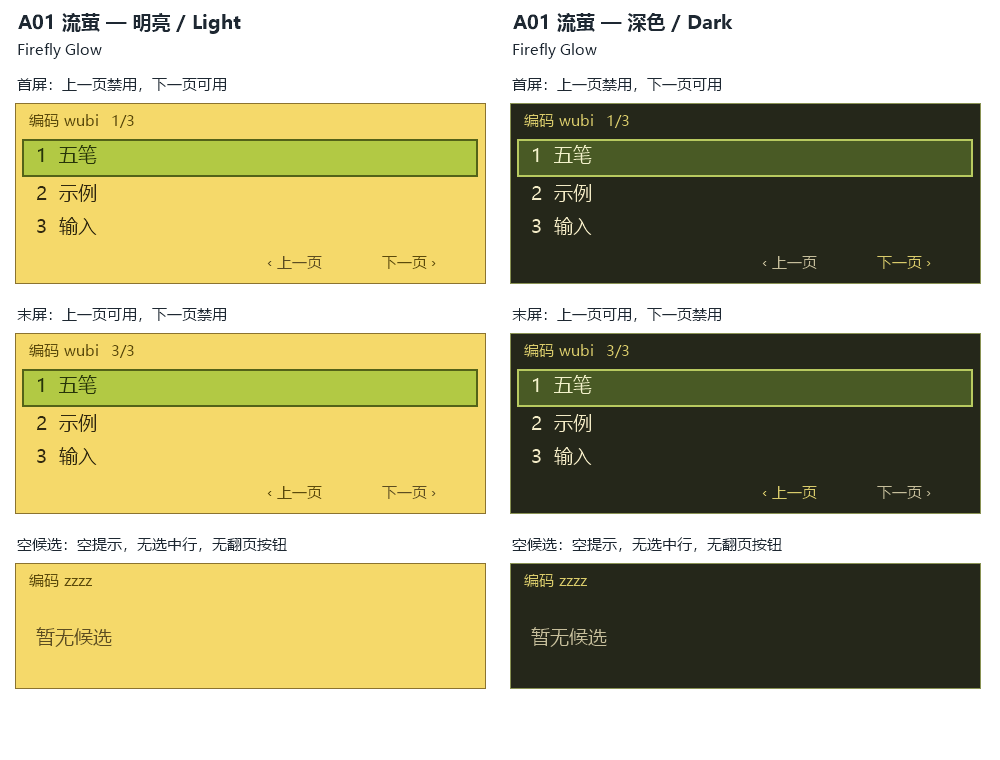

| 注册表字段 | Light | Dark |
|---|---|---|
| Background | `#F5D96A` | `#25271A` |
| Border | `#8B7330` | `#899254` |
| CodeText | `#5B4A0B` | `#D9CB6B` |
| CandidateText | `#30280F` | `#F3EBC6` |
| SecondaryText | `#5C4D21` | `#C6BE9B` |
| SelectedBackground | `#B2C944` | `#495A25` |
| SelectedText | `#273509` | `#F3F2CB` |
| SelectedBorder | `#536218` | `#B8CA60` |
| EmptyText | `#5C4D21` | `#C6BE9B` |
| PageEnabledText | `#5B4A0B` | `#D9CB6B` |
| PageDisabledText | `#5C4D21` | `#C6BE9B` |
| MenuHoverBackground | `#E5C856` | `#343C20` |
| MenuHoverText | `#30280F` | `#F3EBC6` |

## A02 墨砚 / Inkstone

稳定标识：`inkstone`。
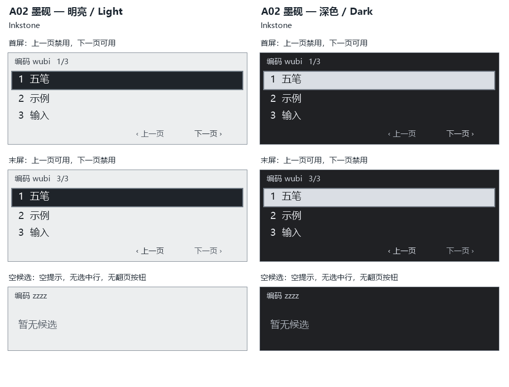

| 注册表字段 | Light | Dark |
|---|---|---|
| Background | `#ECEEEF` | `#202124` |
| Border | `#858E98` | `#727A85` |
| CodeText | `#313942` | `#D8DDE5` |
| CandidateText | `#1E242A` | `#ECEFF3` |
| SecondaryText | `#515963` | `#B1B7C0` |
| SelectedBackground | `#1F242A` | `#DADEE4` |
| SelectedText | `#FFFFFF` | `#16191D` |
| SelectedBorder | `#737D87` | `#777F89` |
| EmptyText | `#515963` | `#B1B7C0` |
| PageEnabledText | `#313942` | `#D8DDE5` |
| PageDisabledText | `#515963` | `#B1B7C0` |
| MenuHoverBackground | `#D8DEE4` | `#35383D` |
| MenuHoverText | `#1E242A` | `#ECEFF3` |

## A03 碧潭 / Jade Pool

稳定标识：`jade-pool`。
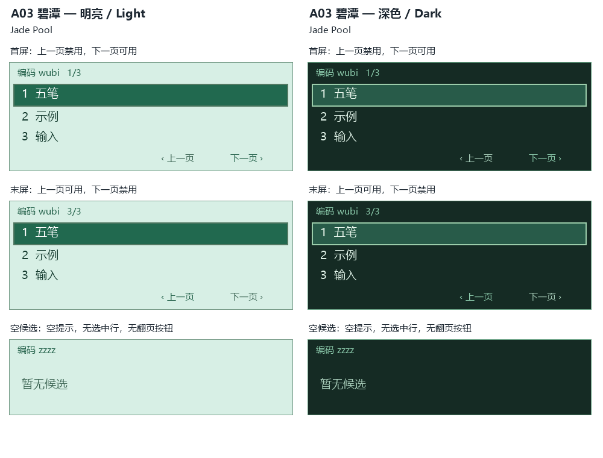

| 注册表字段 | Light | Dark |
|---|---|---|
| Background | `#D7EFE5` | `#152B24` |
| Border | `#6F9581` | `#5D997A` |
| CodeText | `#215F48` | `#8DCCAD` |
| CandidateText | `#163C30` | `#E0F2E8` |
| SecondaryText | `#3D6554` | `#A8CDBA` |
| SelectedBackground | `#21694F` | `#285B49` |
| SelectedText | `#FFFFFF` | `#E9F7ED` |
| SelectedBorder | `#527963` | `#9CCDAB` |
| EmptyText | `#3D6554` | `#A8CDBA` |
| PageEnabledText | `#215F48` | `#8DCCAD` |
| PageDisabledText | `#3D6554` | `#A8CDBA` |
| MenuHoverBackground | `#BCE0D0` | `#203F33` |
| MenuHoverText | `#163C30` | `#E0F2E8` |

## A04 星渊 / Starry Abyss

稳定标识：`starry-abyss`。
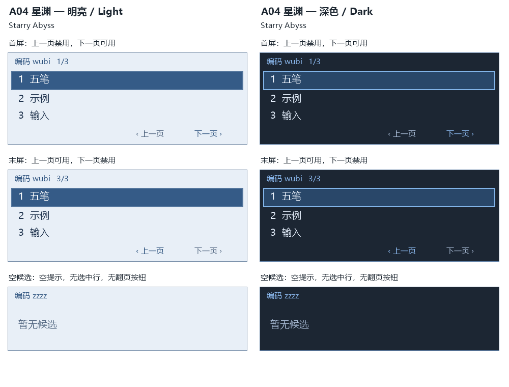

| 注册表字段 | Light | Dark |
|---|---|---|
| Background | `#E8EFF7` | `#1C2633` |
| Border | `#7990AA` | `#5F7FA5` |
| CodeText | `#2F547F` | `#8CBAF0` |
| CandidateText | `#20344E` | `#E3EDFA` |
| SecondaryText | `#4E637E` | `#A9BCD6` |
| SelectedBackground | `#355B87` | `#294769` |
| SelectedText | `#FFFFFF` | `#EFF5FE` |
| SelectedBorder | `#54769D` | `#82B4E8` |
| EmptyText | `#4E637E` | `#A9BCD6` |
| PageEnabledText | `#2F547F` | `#8CBAF0` |
| PageDisabledText | `#4E637E` | `#A9BCD6` |
| MenuHoverBackground | `#CCDAEC` | `#25364C` |
| MenuHoverText | `#20344E` | `#E3EDFA` |

## A05 秋绮 / Autumn Brocade

稳定标识：`autumn-brocade`。
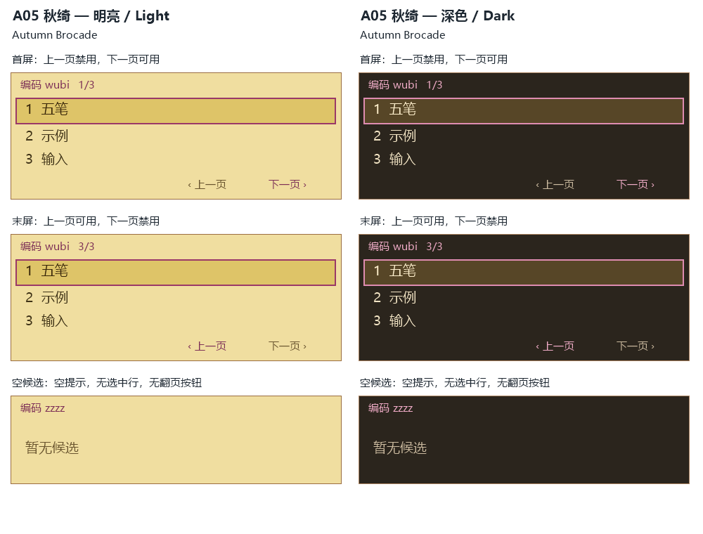

| 注册表字段 | Light | Dark |
|---|---|---|
| Background | `#F0DEA0` | `#2B251D` |
| Border | `#9B6E42` | `#AD8562` |
| CodeText | `#7E3157` | `#F0ACC7` |
| CandidateText | `#3F3216` | `#F3E5C5` |
| SecondaryText | `#69542E` | `#CCBBA0` |
| SelectedBackground | `#DEC468` | `#574627` |
| SelectedText | `#382609` | `#FFF0CD` |
| SelectedBorder | `#9A3868` | `#DF8CB1` |
| EmptyText | `#69542E` | `#CCBBA0` |
| PageEnabledText | `#7E3157` | `#F0ACC7` |
| PageDisabledText | `#69542E` | `#CCBBA0` |
| MenuHoverBackground | `#E4CF89` | `#3D3223` |
| MenuHoverText | `#3F3216` | `#F3E5C5` |

## A06 竹露 / Bamboo Dew

稳定标识：`bamboo-dew`。
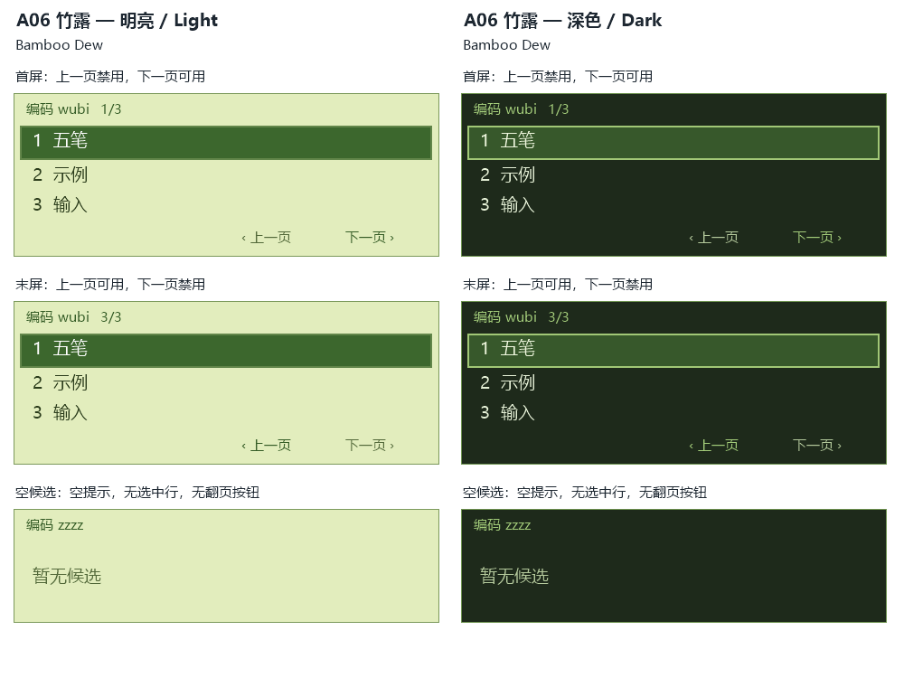

| 注册表字段 | Light | Dark |
|---|---|---|
| Background | `#E2EDBD` | `#1E2A1B` |
| Border | `#7B995B` | `#6F9451` |
| CodeText | `#365D27` | `#A2CB79` |
| CandidateText | `#2C3D1C` | `#E5F0D6` |
| SecondaryText | `#53693A` | `#B3C89B` |
| SelectedBackground | `#3C672D` | `#37582B` |
| SelectedText | `#FFFFFF` | `#EEF6DD` |
| SelectedBorder | `#62864A` | `#A1C776` |
| EmptyText | `#53693A` | `#B3C89B` |
| PageEnabledText | `#365D27` | `#A2CB79` |
| PageDisabledText | `#53693A` | `#B3C89B` |
| MenuHoverBackground | `#CDDEA0` | `#2B3D23` |
| MenuHoverText | `#2C3D1C` | `#E5F0D6` |

## B01 素笺 / Ivory Paper

稳定标识：`ivory-paper`。
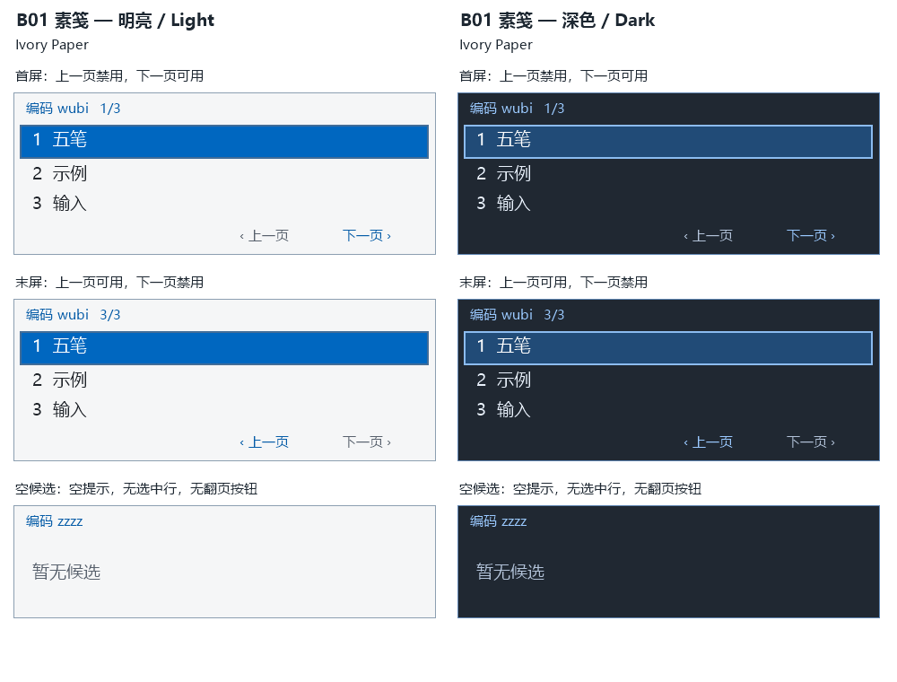

| 注册表字段 | Light | Dark |
|---|---|---|
| Background | `#F5F6F7` | `#202832` |
| Border | `#8C9FB1` | `#6086B3` |
| CodeText | `#075DA8` | `#9AC9FF` |
| CandidateText | `#20242A` | `#E8F0FB` |
| SecondaryText | `#58616D` | `#B2C2D8` |
| SelectedBackground | `#0067C0` | `#214B77` |
| SelectedText | `#FFFFFF` | `#FFFFFF` |
| SelectedBorder | `#426D98` | `#8CBCF0` |
| EmptyText | `#58616D` | `#B2C2D8` |
| PageEnabledText | `#075DA8` | `#9AC9FF` |
| PageDisabledText | `#58616D` | `#B2C2D8` |
| MenuHoverBackground | `#DCEAF7` | `#2B3C51` |
| MenuHoverText | `#20242A` | `#E8F0FB` |

## B02 玄夜 / Obsidian Night

稳定标识：`obsidian-night`。
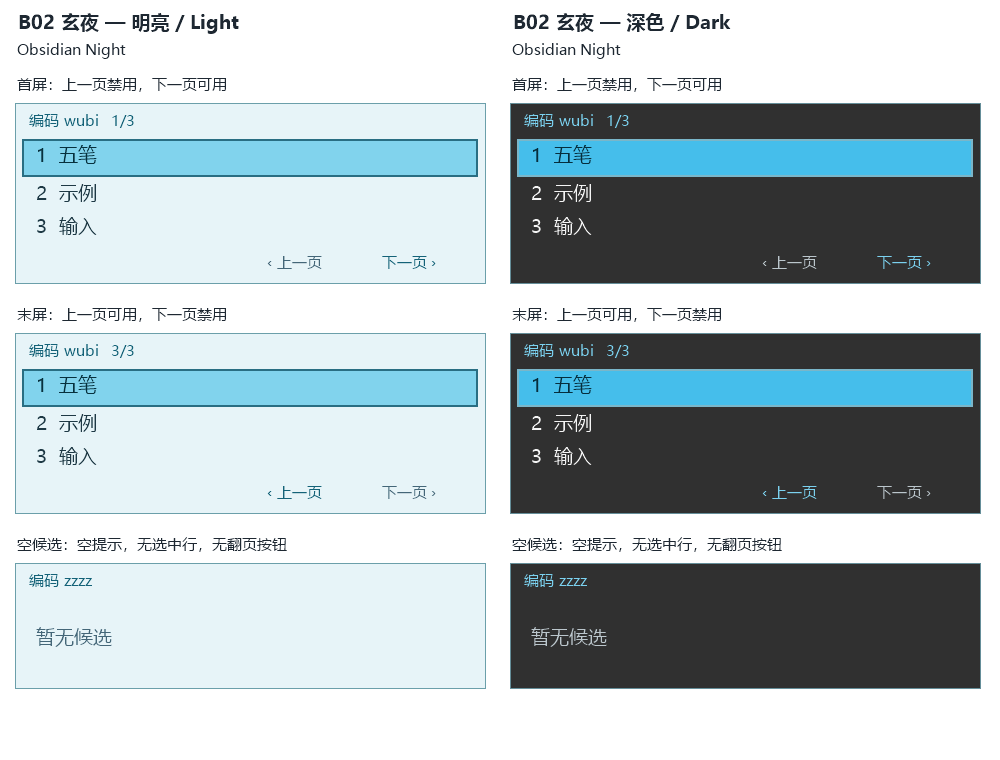

| 注册表字段 | Light | Dark |
|---|---|---|
| Background | `#E7F4F8` | `#303030` |
| Border | `#6B9FAA` | `#658E99` |
| CodeText | `#146278` | `#7BD1EF` |
| CandidateText | `#1E3945` | `#F4F4F4` |
| SecondaryText | `#446678` | `#BBC6CC` |
| SelectedBackground | `#81D3ED` | `#45BEEB` |
| SelectedText | `#07313E` | `#062E3D` |
| SelectedBorder | `#296E83` | `#7AB6C9` |
| EmptyText | `#446678` | `#BBC6CC` |
| PageEnabledText | `#146278` | `#7BD1EF` |
| PageDisabledText | `#446678` | `#BBC6CC` |
| MenuHoverBackground | `#CCE9F3` | `#344751` |
| MenuHoverText | `#1E3945` | `#F4F4F4` |

## B03 冰绡 / Icy Silk

稳定标识：`icy-silk`。
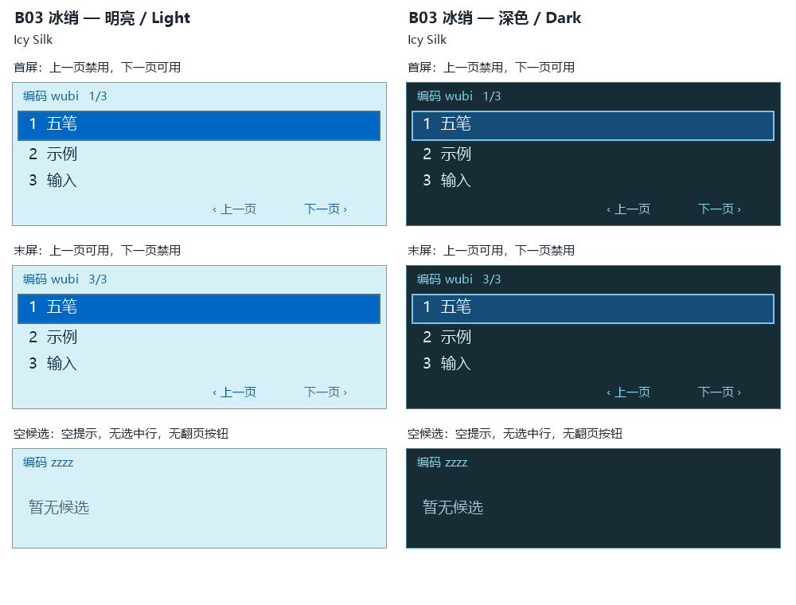

| 注册表字段 | Light | Dark |
|---|---|---|
| Background | `#D5F1F7` | `#172C35` |
| Border | `#749EB5` | `#477E94` |
| CodeText | `#155E9B` | `#84D9EE` |
| CandidateText | `#102F3C` | `#DDF4FA` |
| SecondaryText | `#466775` | `#AACCD8` |
| SelectedBackground | `#0068C4` | `#174B78` |
| SelectedText | `#FFFFFF` | `#F7FCFF` |
| SelectedBorder | `#407395` | `#78C5E9` |
| EmptyText | `#466775` | `#AACCD8` |
| PageEnabledText | `#155E9B` | `#84D9EE` |
| PageDisabledText | `#466775` | `#AACCD8` |
| MenuHoverBackground | `#B8E0EE` | `#233F4D` |
| MenuHoverText | `#102F3C` | `#DDF4FA` |

## B04 墨印 / Ink Seal

稳定标识：`ink-seal`。
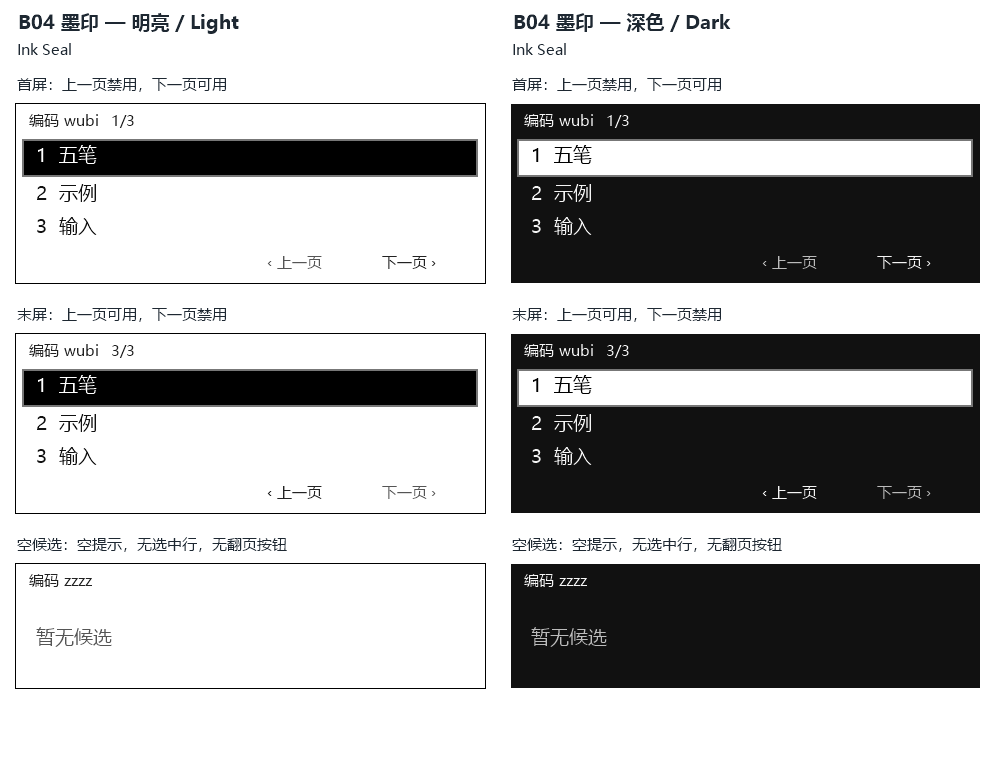

| 注册表字段 | Light | Dark |
|---|---|---|
| Background | `#FFFFFF` | `#111111` |
| Border | `#000000` | `#FFFFFF` |
| CodeText | `#222222` | `#F4F4F4` |
| CandidateText | `#111111` | `#F4F4F4` |
| SecondaryText | `#555555` | `#BBBBBB` |
| SelectedBackground | `#000000` | `#FFFFFF` |
| SelectedText | `#FFFFFF` | `#000000` |
| SelectedBorder | `#777777` | `#777777` |
| EmptyText | `#555555` | `#BBBBBB` |
| PageEnabledText | `#222222` | `#F4F4F4` |
| PageDisabledText | `#555555` | `#BBBBBB` |
| MenuHoverBackground | `#E0E0E0` | `#303030` |
| MenuHoverText | `#111111` | `#F4F4F4` |

## B05 赭霞 / Terracotta Dusk

稳定标识：`terracotta-dusk`。
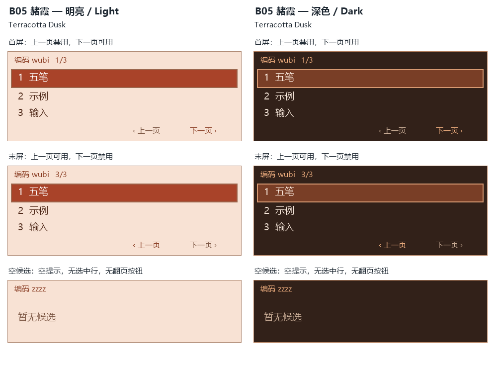

| 注册表字段 | Light | Dark |
|---|---|---|
| Background | `#F8E2D4` | `#322119` |
| Border | `#AF8973` | `#B47F5D` |
| CodeText | `#883B21` | `#F1B080` |
| CandidateText | `#4E2818` | `#F7E8DB` |
| SecondaryText | `#77513E` | `#D0B39C` |
| SelectedBackground | `#A94329` | `#793E26` |
| SelectedText | `#FFFFFF` | `#FFF0E5` |
| SelectedBorder | `#9B664D` | `#D79972` |
| EmptyText | `#77513E` | `#D0B39C` |
| PageEnabledText | `#883B21` | `#F1B080` |
| PageDisabledText | `#77513E` | `#D0B39C` |
| MenuHoverBackground | `#EECBB5` | `#4B3023` |
| MenuHoverText | `#4E2818` | `#F7E8DB` |

## B06 烟岚 / Smoky Mist

稳定标识：`smoky-mist`。
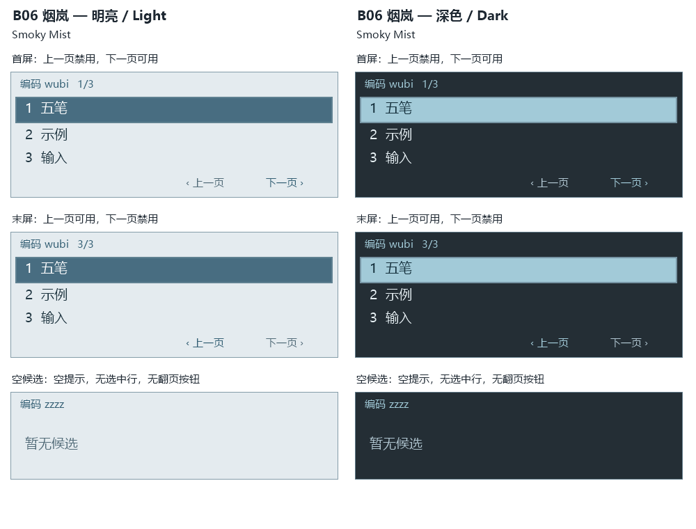

| 注册表字段 | Light | Dark |
|---|---|---|
| Background | `#E4EBEF` | `#242E35` |
| Border | `#849CA8` | `#647E8D` |
| CodeText | `#345F74` | `#A2CAD8` |
| CandidateText | `#203641` | `#E8F1F5` |
| SecondaryText | `#526B78` | `#B1C6D1` |
| SelectedBackground | `#486D81` | `#A2CAD8` |
| SelectedText | `#FFFFFF` | `#122D39` |
| SelectedBorder | `#5F8191` | `#7795A4` |
| EmptyText | `#526B78` | `#B1C6D1` |
| PageEnabledText | `#345F74` | `#A2CAD8` |
| PageDisabledText | `#526B78` | `#B1C6D1` |
| MenuHoverBackground | `#CCDAE3` | `#33444F` |
| MenuHoverText | `#203641` | `#E8F1F5` |

## B07 银霜 / Silver Frost

稳定标识：`silver-frost`。
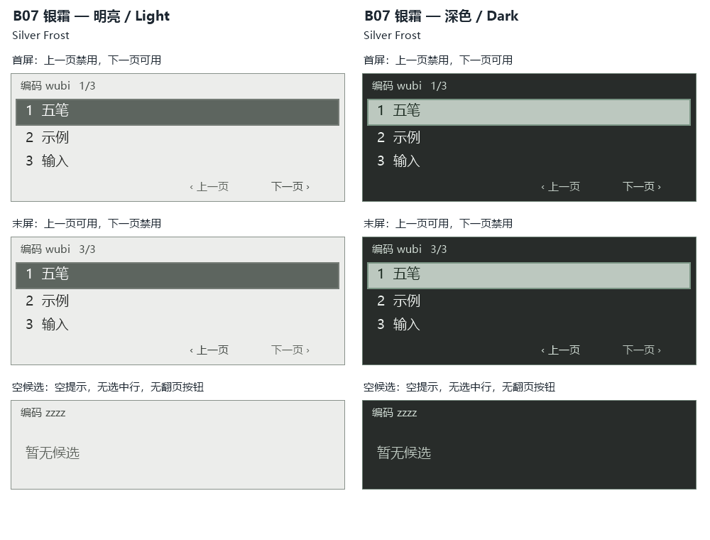

| 注册表字段 | Light | Dark |
|---|---|---|
| Background | `#ECEDEB` | `#282C2A` |
| Border | `#89928B` | `#6D8175` |
| CodeText | `#444A46` | `#D2DED6` |
| CandidateText | `#2B2D2C` | `#EDF1EE` |
| SecondaryText | `#626761` | `#BDC8C0` |
| SelectedBackground | `#5D655F` | `#BCC8BF` |
| SelectedText | `#FFFFFF` | `#1B2A20` |
| SelectedBorder | `#747B75` | `#7B9685` |
| EmptyText | `#626761` | `#BDC8C0` |
| PageEnabledText | `#444A46` | `#D2DED6` |
| PageDisabledText | `#626761` | `#BDC8C0` |
| MenuHoverBackground | `#D8DDD9` | `#3B443E` |
| MenuHoverText | `#2B2D2C` | `#EDF1EE` |

## B08 落霞 / Sunset Clouds

稳定标识：`sunset-clouds`。
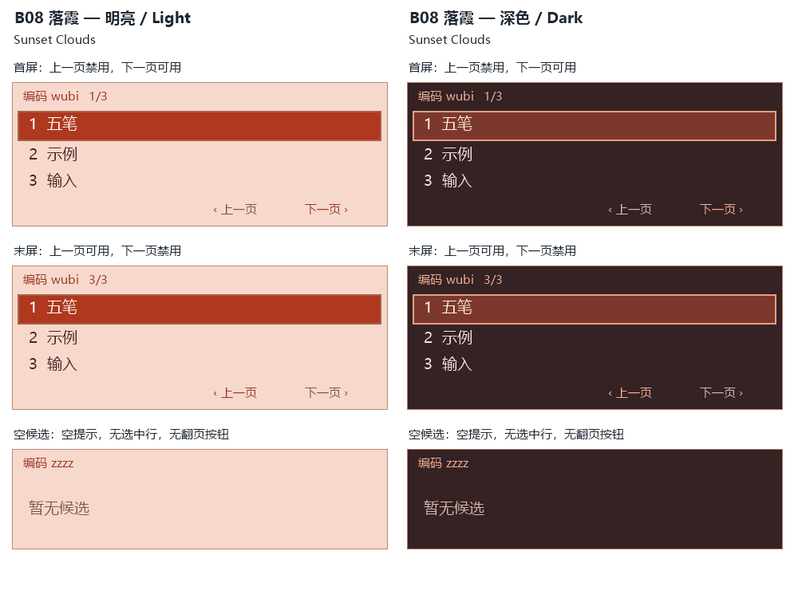

| 注册表字段 | Light | Dark |
|---|---|---|
| Background | `#F7D8CC` | `#342224` |
| Border | `#BC8877` | `#B47B66` |
| CodeText | `#9B3928` | `#F4AF93` |
| CandidateText | `#50241F` | `#FAE4DC` |
| SecondaryText | `#815349` | `#DAB8AD` |
| SelectedBackground | `#AF381E` | `#7D382D` |
| SelectedText | `#FFFFFF` | `#FFF1E7` |
| SelectedBorder | `#A9614B` | `#E4A080` |
| EmptyText | `#815349` | `#DAB8AD` |
| PageEnabledText | `#9B3928` | `#F4AF93` |
| PageDisabledText | `#815349` | `#DAB8AD` |
| MenuHoverBackground | `#EEC0AB` | `#4B2F2B` |
| MenuHoverText | `#50241F` | `#FAE4DC` |

## B09 紫陌 / Violet Path

稳定标识：`violet-path`。
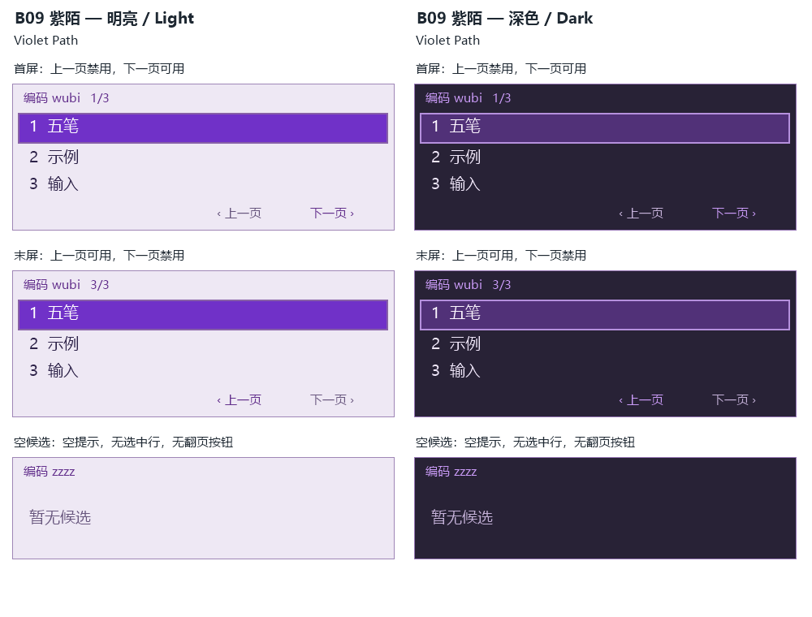

| 注册表字段 | Light | Dark |
|---|---|---|
| Background | `#EEE8F4` | `#282236` |
| Border | `#9F86B6` | `#9574B4` |
| CodeText | `#63308C` | `#C99AF6` |
| CandidateText | `#2E2349` | `#F0E7FA` |
| SecondaryText | `#68577E` | `#C4B1D8` |
| SelectedBackground | `#7031C8` | `#513178` |
| SelectedText | `#FFFFFF` | `#FCF5FF` |
| SelectedBorder | `#8760A7` | `#B590DD` |
| EmptyText | `#68577E` | `#C4B1D8` |
| PageEnabledText | `#63308C` | `#C99AF6` |
| PageDisabledText | `#68577E` | `#C4B1D8` |
| MenuHoverBackground | `#DFD1EC` | `#3B2D4F` |
| MenuHoverText | `#2E2349` | `#F0E7FA` |

## B10 茶烟 / Tea Mist

稳定标识：`tea-mist`。
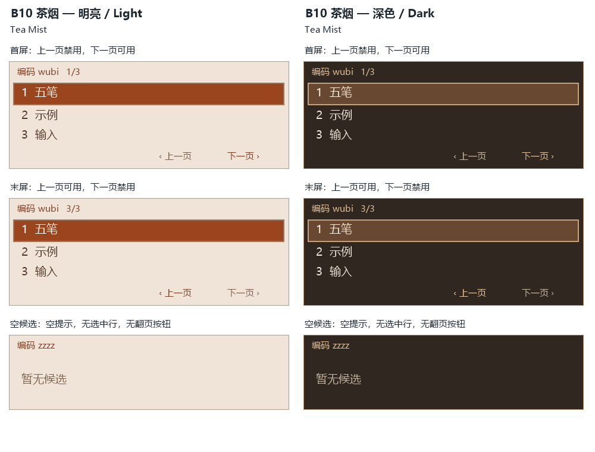

| 注册表字段 | Light | Dark |
|---|---|---|
| Background | `#F0E3D8` | `#302820` |
| Border | `#B59A84` | `#A98565` |
| CodeText | `#7D3D22` | `#E9C39B` |
| CandidateText | `#503629` | `#F4EADD` |
| SecondaryText | `#7A5E4A` | `#CCB9A1` |
| SelectedBackground | `#9B451E` | `#684831` |
| SelectedText | `#FFFFFF` | `#FFF1E3` |
| SelectedBorder | `#9B765C` | `#C7A17B` |
| EmptyText | `#7A5E4A` | `#CCB9A1` |
| PageEnabledText | `#7D3D22` | `#E9C39B` |
| PageDisabledText | `#7A5E4A` | `#CCB9A1` |
| MenuHoverBackground | `#E4D0BF` | `#45362A` |
| MenuHoverText | `#503629` | `#F4EADD` |

## B11 沧澜 / Azure Tides

稳定标识：`azure-tides`。
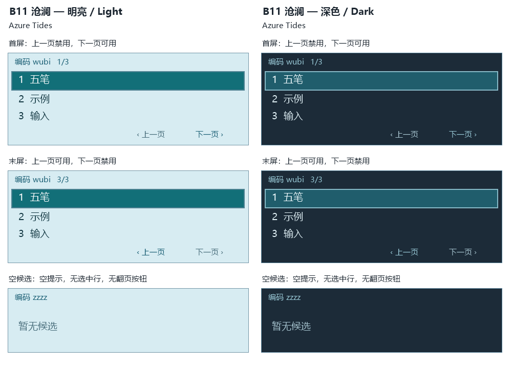

| 注册表字段 | Light | Dark |
|---|---|---|
| Background | `#D7ECF2` | `#1C2B38` |
| Border | `#7395A6` | `#5B869D` |
| CodeText | `#175C72` | `#9DCEDC` |
| CandidateText | `#123742` | `#E2F2F7` |
| SecondaryText | `#436876` | `#ABC9D4` |
| SelectedBackground | `#126F78` | `#205D6C` |
| SelectedText | `#FFFFFF` | `#F1FBFE` |
| SelectedBorder | `#4D8191` | `#87BAC8` |
| EmptyText | `#436876` | `#ABC9D4` |
| PageEnabledText | `#175C72` | `#9DCEDC` |
| PageDisabledText | `#436876` | `#ABC9D4` |
| MenuHoverBackground | `#BDDEEB` | `#2A4152` |
| MenuHoverText | `#123742` | `#E2F2F7` |

## B12 霁雪 / Thawing Snow

稳定标识：`thawing-snow`。
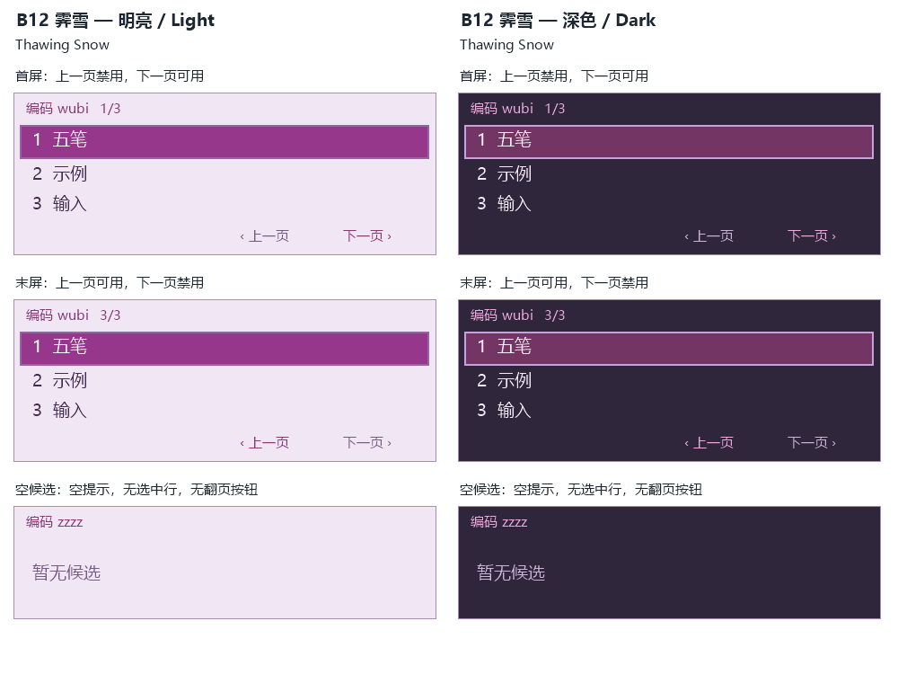

| 注册表字段 | Light | Dark |
|---|---|---|
| Background | `#F1E7F4` | `#2F263C` |
| Border | `#AA8DB8` | `#A684B9` |
| CodeText | `#873976` | `#EDAADE` |
| CandidateText | `#422B4C` | `#F5EAF8` |
| SecondaryText | `#755A83` | `#CEB5D8` |
| SelectedBackground | `#96378C` | `#723564` |
| SelectedText | `#FFFFFF` | `#FFF4FD` |
| SelectedBorder | `#9763A3` | `#C7A1DD` |
| EmptyText | `#755A83` | `#CEB5D8` |
| PageEnabledText | `#873976` | `#EDAADE` |
| PageDisabledText | `#755A83` | `#CEB5D8` |
| MenuHoverBackground | `#DFD8F0` | `#44354F` |
| MenuHoverText | `#422B4C` | `#F5EAF8` |

## B13 春汀 / Spring Shore

稳定标识：`spring-shore`。
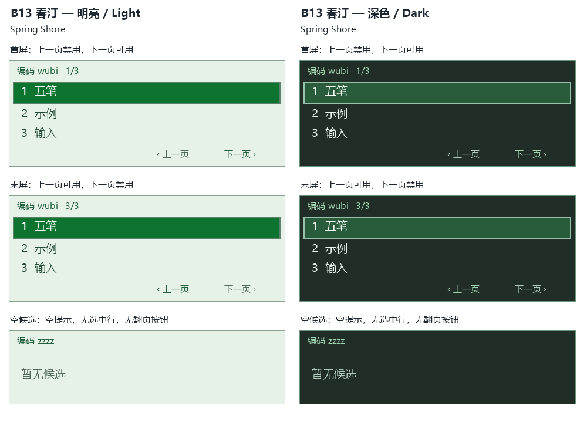

| 注册表字段 | Light | Dark |
|---|---|---|
| Background | `#E6F1E7` | `#202E27` |
| Border | `#87A191` | `#6B947D` |
| CodeText | `#21613D` | `#9FD3B0` |
| CandidateText | `#234B35` | `#E8F4EC` |
| SecondaryText | `#536B5C` | `#AFCBBC` |
| SelectedBackground | `#0D742F` | `#285C3B` |
| SelectedText | `#FFFFFF` | `#EFFAF1` |
| SelectedBorder | `#5C816A` | `#99C1AC` |
| EmptyText | `#536B5C` | `#AFCBBC` |
| PageEnabledText | `#21613D` | `#9FD3B0` |
| PageDisabledText | `#536B5C` | `#AFCBBC` |
| MenuHoverBackground | `#CEE1D4` | `#304336` |
| MenuHoverText | `#234B35` | `#E8F4EC` |

## B14 桃夭 / Peach Blossom

稳定标识：`peach-blossom`。
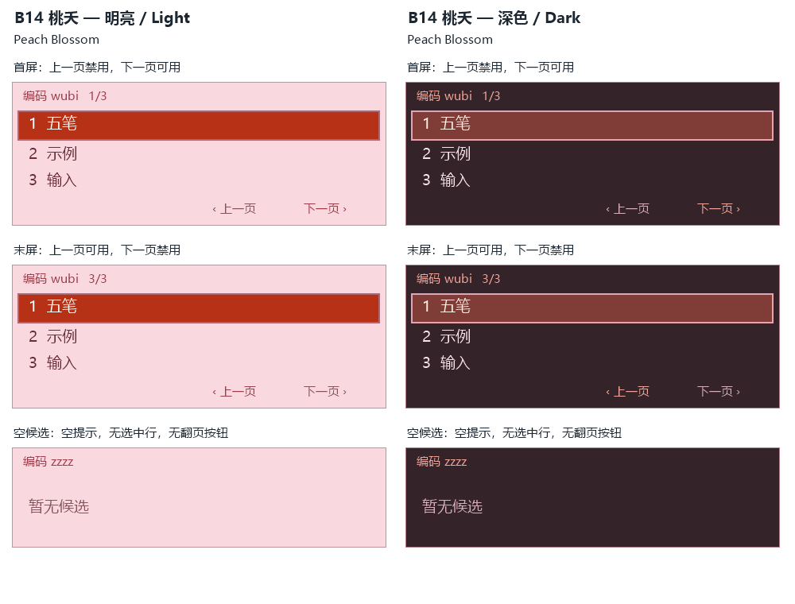

| 注册表字段 | Light | Dark |
|---|---|---|
| Background | `#F9D8DF` | `#35232A` |
| Border | `#C39299` | `#B27C86` |
| CodeText | `#9D3D4B` | `#F1A599` |
| CandidateText | `#672D38` | `#F9E4E9` |
| SecondaryText | `#86525B` | `#D9ADB9` |
| SelectedBackground | `#B63115` | `#803D37` |
| SelectedText | `#FFFFFF` | `#FFF1E5` |
| SelectedBorder | `#AD6773` | `#E7A3B2` |
| EmptyText | `#86525B` | `#D9ADB9` |
| PageEnabledText | `#9D3D4B` | `#F1A599` |
| PageDisabledText | `#86525B` | `#D9ADB9` |
| MenuHoverBackground | `#F0BECA` | `#4D2E35` |
| MenuHoverText | `#672D38` | `#F9E4E9` |

## B15 翠微 / Emerald Haze

稳定标识：`emerald-haze`。
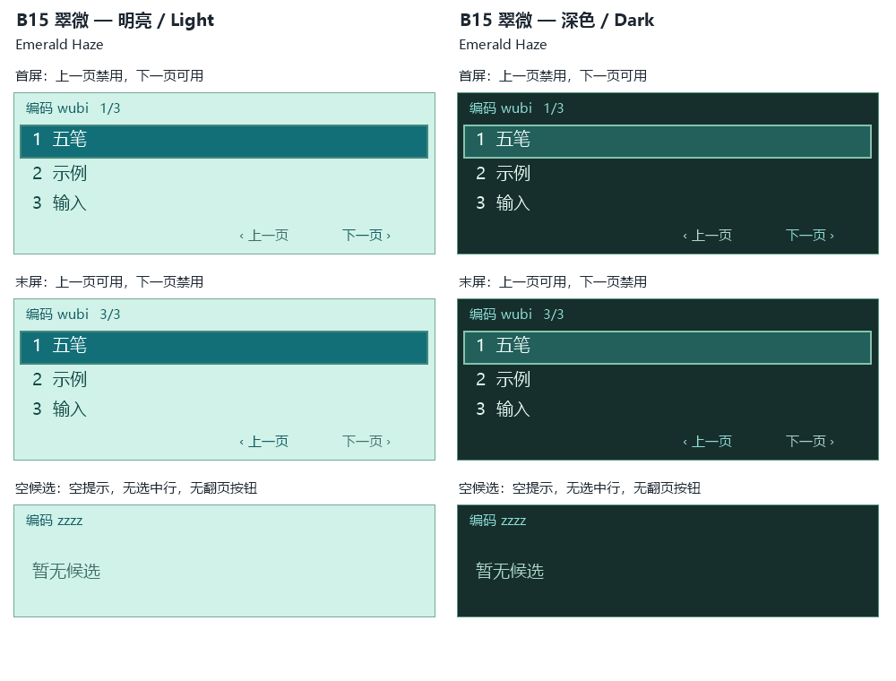

| 注册表字段 | Light | Dark |
|---|---|---|
| Background | `#D0F2E8` | `#172F2C` |
| Border | `#76A89A` | `#579981` |
| CodeText | `#155F65` | `#8CDDD7` |
| CandidateText | `#134A48` | `#E1F7EF` |
| SecondaryText | `#406F68` | `#ABD7C8` |
| SelectedBackground | `#126F78` | `#235F5B` |
| SelectedText | `#FFFFFF` | `#F0FCF7` |
| SelectedBorder | `#45877E` | `#82C5AC` |
| EmptyText | `#406F68` | `#ABD7C8` |
| PageEnabledText | `#155F65` | `#8CDDD7` |
| PageDisabledText | `#406F68` | `#ABD7C8` |
| MenuHoverBackground | `#ADE3D1` | `#244640` |
| MenuHoverText | `#134A48` | `#E1F7EF` |
