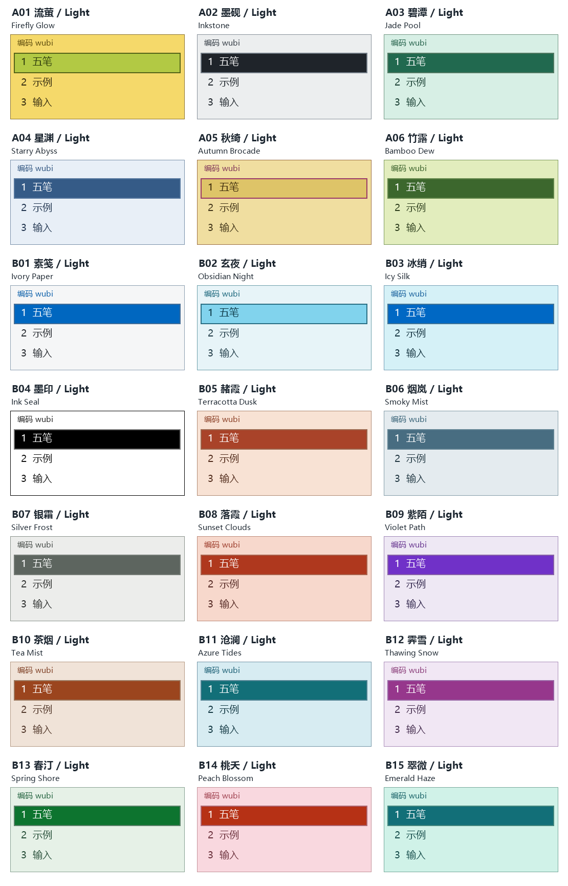
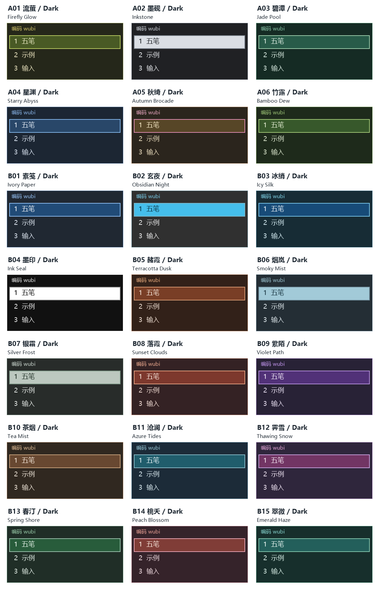
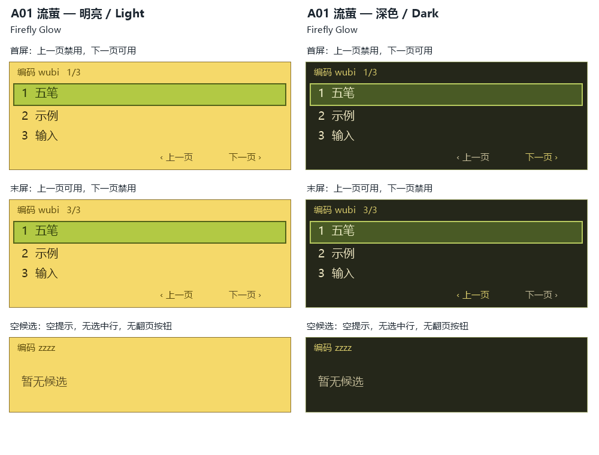

# 输入法皮肤设计与双语命名 / IME Skin Designs

日期：2026-11-16。状态：**设计草案，不是已实现的皮肤功能**。

## 1. 设计范围与命名原则

本稿整理 **21 套皮肤设计方案**：六套基础配色与十五套扩展配色。
“跟随系统”属于主题选择行为，不作为固定皮肤命名。
中文名均为两个汉字，以自然、时令和文房意象命名；英文名表达同一意境，
不要求逐字翻译。名称均为本项目的设计建议。
A01～A06、B01～B15 仅用于本稿图例对照，不是配置格式或最终产品标识。

### 图例说明

第 5 节为本项目绘制的候选样式示意，用统一布局比较各套配色，
不是软件运行截图。HEX 色值是设计建议，不代表皮肤功能已经实现。

## 2. 六套基础配色：大色块与选中行

这组方案以“大字号、竖排、首行高亮”的统一结构展示。主题个性主要来自底色、
首行与正文的明暗差以及边缘装饰，而不是复杂图案。

### A01 流萤 / Firefly Glow

- **样式特征**：金黄与黄绿对照。明亮版用亮金底深字，深色版用暖墨底浅字，
  两版都保留金黄和黄绿强调。
- **名字意境**：黄绿如萤火，金黄如夏夜余光，活泼而有温度。
- **设计要点**：用金黄与黄绿形成活泼对照，以细边框表达选中，
  避免白字配亮黄底；彩色光晕继续延后。

### A02 墨砚 / Inkstone

- **样式特征**：灰黑文房色。明亮版浅灰底、黑色选中行；深色版炭灰底、
  浅灰选中行，文字相应调整，装饰克制。
- **名字意境**：灰如砚台、黑如浓墨，朴素、安定，带文房气息。
- **设计要点**：适合作为简洁基准方案。保留灰纸或墨灰质感，不加入彩色装饰，
  用文字与选中行的明暗反差、细分隔线表达选择。

### A03 碧潭 / Jade Pool

- **样式特征**：明亮版薄碧底深绿字，深色版墨绿底浅字；
  选中行保留深绿底浅字，以碧绿边框加强区分。
- **名字意境**：碧水深潭，清凉、沉静，不是明亮的草绿色。
- **设计要点**：用首行与正文的明暗差强化选择提示，
  不只依赖发光或一条分隔线。

### A04 星渊 / Starry Abyss

- **样式特征**：明亮版淡蓝灰底深字，深色版炭蓝底浅字；
  选中行保持蓝色，配细蓝边框。
- **名字意境**：深色如夜渊，蓝色如星光，冷静而有纵深。
- **设计要点**：主体亮度由明暗变体决定，蓝色集中在选中行和焦点边框，
  不把每个控件都涂成亮蓝色。

### A05 秋绮 / Autumn Brocade

- **样式特征**：明亮版麦金底深字，深色版暖褐底浅字；
  金黄与玫红强调共同表达秋日锦绮。
- **名字意境**：秋日金黄与锦绮玫红交织，柔暖中带一点华丽。
- **设计要点**：用芥黄与粉红表达暖色个性，粉色集中用于选中边框，
  不把光晕当作一期实现要求。

### A06 竹露 / Bamboo Dew

- **样式特征**：明亮版浅黄绿底深字，深色版深叶绿底浅字；
  选中行深绿底浅字，并保留竹绿色边框。
- **名字意境**：晨竹带露，清新、轻盈，适合自然色系。
- **设计要点**：以绿色层次和边框区分正文和选中行，
  保留清爽感，降低荧光边缘的存在感。

## 3. 十五套扩展配色：中性与柔和渐变

扩展方案进一步覆盖黑白、灰蓝、暖赭、粉彩及冷暖渐变。
各套配色仍使用相同的文字、背景、选中与强调色角色。

| 编号 | 中文 / English | 名字意境 | 样式特征与设计建议 |
|---|---|---|---|
| B01 | 素笺 / Ivory Paper | 未染的纸笺，清净留白 | 白与浅灰、蓝色强调。白底深字，选中行集中使用蓝色；适合日常简洁风格。 |
| B02 | 玄夜 / Obsidian Night | 玄色夜幕，一点清亮 | 炭黑与深灰、亮青蓝强调。暗底浅字，青蓝选中行用深色字，避免白字配亮青底。 |
| B03 | 冰绡 / Icy Silk | 薄冰与轻绡，透亮清凉 | 冰蓝底、浓蓝强调。浅蓝正文深字，选中行深蓝白字，不依赖真实窗口透明。 |
| B04 | 墨印 / Ink Seal | 白纸上的鲜明墨印 | 纯黑白与较强黑描边。是一套纯色设计，不等于系统高对比度模式或无障碍认证。 |
| B05 | 赭霞 / Terracotta Dusk | 赭土与晚霞，温厚沉稳 | 砖红底、暖橙强调。正文浅字、橙色选中行深字；控制大面积红色的刺激感。 |
| B06 | 烟岚 / Smoky Mist | 青灰山岚，含蓄微凉 | 蓝灰底、雾蓝强调。正文深字，选中行用雾蓝底和更深的文字，保留低饱和气质。 |
| B07 | 银霜 / Silver Frost | 银色霜面，冷静柔和 | 中灰底、银灰强调，无明显彩色倾向。正文浅字，浅灰选中行深字。 |
| B08 | 落霞 / Sunset Clouds | 日落云霞，流动暖光 | 橙粉暖色渐变、暖红强调。正文深暖色字，选中行红底白字，避免繁密图案。 |
| B09 | 紫陌 / Violet Path | 紫色远陌，含蓄雅致 | 淡紫到灰紫的柔光过渡、浓紫强调。正文深紫字，选中行浓紫白字。 |
| B10 | 茶烟 / Tea Mist | 暖茶与轻烟，舒缓温润 | 米色到茶色的暖调渐变、茶褐强调。正文深褐字，选中行茶褐白字。 |
| B11 | 沧澜 / Azure Tides | 青碧水澜与远处天色 | 青蓝到淡紫的简化渐变、深青强调。正文深青字，深青选中行配白字。 |
| B12 | 霁雪 / Thawing Snow | 雪后初霁，浅色清光 | 淡粉紫到冰蓝的柔和过渡、紫红强调。适合轻盈冷色风格；正文深紫，选中行紫红白字。 |
| B13 | 春汀 / Spring Shore | 春水岸边，草色初生 | 淡绿到淡紫、深绿强调。更柔和、偏粉彩，区别于 A06 的黄绿与深绿对照。 |
| B14 | 桃夭 / Peach Blossom | 桃花与暖日，明媚柔润 | 粉色到杏橙、暖红强调。正文深暖色字，选中行红底白字，兼顾明媚与可读性。 |
| B15 | 翠微 / Emerald Haze | 山间青翠薄雾，鲜润轻快 | 青蓝到薄荷绿、深青强调。以清亮渐变区别于 A03 的碧绿底，不增加高频装饰。 |

## 4. 风格分组与差异

| 风格家族 | 对照方案 | 相似点与保留差异 |
|---|---|---|
| 文房中性 | A02、B01、B04、B07 | 都偏简洁；分别是灰纸黑条、白纸蓝条、纯黑白强描边、中灰银条，不必直接合并。 |
| 夜色冷调 | A04、B02 | 都是暗底；A04 的选中行仍偏深蓝，B02 使用亮青蓝与深色选中字，视觉强度不同。 |
| 金黄暖调 | A01、A05、B05、B08、B10、B14 | A01 黄绿活泼，A05 芥黄粉边，其他分别偏赭橙、晚霞、米茶、桃杏，情绪不同。 |
| 青绿自然 | A03、A06、B03、B11、B13、B15 | 分别强调碧绿、黄绿、冰蓝、青紫、粉彩绿紫、青蓝薄荷，不宜只按“绿色”合并。 |
| 紫色柔光 | B09、B12 | B09 偏灰紫柔光，B12 偏雪后粉紫与冰蓝；一浓一轻。 |
| 灰蓝雾感 | B06 | 和 B07 同属低饱和方向，但蓝灰与雾蓝的冷色倾向更明显。 |

**建议保留全部 21 个名字作为候选目录，不等于一次上线 21 套。**
一期已确定为 A01～A06 与 B01～B15 全部二十一套皮肤，
每套各有明亮和深色版本，共四十二份配色，不再把十五套扩展配色的配对延后。

## 5. 四十二份完整配色与候选状态模板

**一期已确定为二十一套皮肤，每套 Light / Dark 两份，共四十二份配置。**
两版共用同一名称和稳定标识；主题决定明暗，皮肤决定色彩家族。一期全部采用纯色，渐变与材质留给二期。

完整数据见[逐套明暗配色表](ime-skin-palettes.md)，可导入格式见[注册表设计模板](ime-skins.reg)。
注册表文件尚未导入；现有软件尚未实现读取这些皮肤配置。字段和存储规则见[注册表配置契约](#84-注册表配置契约)。

### 明亮总览



### 深色总览



### 完整状态模板

每套皮肤均有左右明暗对照图，包含首屏、末屏和空候选三个情境，不再只展示选中行。
所有二十一套完整图例均收录在[配色表](ime-skin-palettes.md)。下面以流萤展示统一模板：



| 元素 | 模板中的位置 / 状态 | 必需注册表字段 |
|---|---|---|
| 底板 | 每个候选面板的背景 | Background |
| 外框 | 每个面板边缘的细框 | Border |
| 编码标题 | 面板顶部的虚构编码及页码 | CodeText |
| 候选文字 | 普通候选行 | CandidateText |
| 选中行 | 首屏与末屏的首行背景及文字 | SelectedBackground、SelectedText |
| 选中边框 | 选中行的独立描边 | SelectedBorder |
| 空提示 | 空候选面板的“暂无候选” | EmptyText |
| 翻页可用 | 首屏下一页、末屏上一页 | PageEnabledText |
| 翻页禁用 | 首屏上一页、末屏下一页 | PageDisabledText |

空候选情境没有选中行，也不显示翻页按钮；不得为了展示颜色制造假候选或改变实际分页。
候选编号一期与所在行文字同色。次要文字及菜单悬停另有显式配置字段，不在候选面板里虚构菜单控件。
每份配置的空提示、翻页可用/禁用色都必须单独给出；可以与其他角色取相同值，但不得省略字段或依靠隐式缺省。

图例均为本项目绘制的设计示意，使用虚构文本，不是软件运行截图。
四十二份配置已核对正文、编码、次要文字、空提示、可用/禁用翻页、选中文字、菜单悬停文字：均不低于 **4.5:1**。
选中边框相对普通底板不低于 **3:1**；外框是另一装饰角色，不混用该检查。
颜色对校验不替代真实渲染、字号/DPI、焦点、读屏及输入行为验收。高对比度仍使用既有专用配色或系统颜色。

## 6. 实现边界与后续确认

1. **先配色，后材质**：一期二十一套均提供纯色的明暗配置。
   B08～B15 以相应色系表达风格，渐变与材质后续再评估，不依赖背景图片。
2. **不改变主题边界**：候选窗、自绘菜单与候选预览使用 Windows mode；
   tools、浮动状态条本体与 Tooltip 使用 App mode。皮肤不能给 tools 套上候选配色。
3. **保持独立偏好**：皮肤独立保存，不借用主题或关怀模式字段。
   Windows 系统高对比度必须覆盖皮肤，手选高对比度保持既有语义。
   二十一套全部采用浅/深双变体，不存在只有一版的皮肤。
   主题管明暗、皮肤管风格，选择皮肤不能修改用户的主题模式。
4. **共享解析与降级**：预览、候选窗、自绘菜单复用颜色角色；
   Direct2D 与 GDI 降级保持相同内容、选中提示及可读性。
5. **保留交互**：覆盖长候选、横排换行、竖排、分页、DPI、文字缩放、
   关怀模式、小工作区滚动和高对比度，不用皮肤改变引擎页大小。
6. **材质效果延后**：圆角、普通阴影与细分隔线沿用现有二期计划；
   彩色发光继续暂缓。系统绘制的 TSF 菜单和宿主接管的候选界面不在皮肤控制范围内。

## 7. 哪些界面元素可以支持皮肤

**建议首批范围：候选窗口全部自绘区域 + 输入法自绘快捷菜单 + 设置中的候选预览。**
“可以支持”与“已经接入”不同，以下均为设计建议，不表示功能已经实现。
皮肤首先改变视觉颜色，不改变控件的行为、文字内容和布局规则。

### 7.1 候选窗口内部

| 元素 | 可支持内容 | 接入建议与限制 |
|---|---|---|
| 窗口底板 | 纯色背景、外框颜色 | 一期。渐变、圆角和阴影留给二期，不通过改变窗口拥有者或激活状态实现装饰。 |
| 编码标题与分页信息 | 标题文字、强调色 | 一期沿用现有标题结构。皮肤不改变编码提示、页数或显示内容。 |
| 普通候选 | 文字前景色、整体底色 | 一期。长候选换行、编号及显示顺序保持不变。 |
| 选中候选 | 行背景、文字颜色、选中边框 | 一期。选中状态同时由底色和边框表达，不只靠颜色或发光。 |
| 候选编号与编码提示 | 可选的独立次要文字色 | 二期候选项。目前编号与候选文字合并绘制；独立着色需要拆分绘制和共享测量，不是简单替换字符串颜色。 |
| 上一页 / 下一页 | 可用文字色、禁用文字色 | 一期覆盖已有状态。悬停、按下背景需要新增状态处理，不算现成能力。 |
| 无候选提示 | 提示文字颜色 | 一期可接入文字角色；不得把无候选当成可点击的候选项。 |
| 页内滚动条 | 后续可设计轨道、滑块、箭头颜色 | 当前为原生滚动条，一期保持系统外观。完整皮肤化需要额外控件或绘制适配，并验证滚动、命中、DPI 与可访问性。 |
| 候选分隔线 | 颜色、细线样式 | 二期。线宽及间距属于布局度量，不能由每套纯配色任意改变。 |

候选选中边框**不是键盘焦点框**：候选窗口不激活，不能为了展示皮肤焦点
把正在输入的应用焦点抢过来。编号或提示拆分为不同颜色时，
Direct2D、GDI、测量、换行与命中测试必须使用一致的文本片段和几何信息。

### 7.2 同一套皮肤可以覆盖的其他自绘界面

| 界面 | 可支持的元素 | 默认范围 |
|---|---|---|
| 输入法自绘快捷菜单 | 菜单底色、外框、项文字、悬停/选择底色、勾选标记、分隔线 | 推荐一期接入。菜单从状态栏打开时也按输入法菜单规则处理。 |
| 菜单禁用态与键盘焦点 | 禁用文字、焦点提示 | 必须一起设计。当前禁用字色与焦点绘制存在系统颜色/系统绘制路径，不能仅替换菜单底色就宣称完整支持。 |
| 设置中的候选预览 | 候选底板、标题、文字、选中行与边框 | 推荐一期同步，复用相同颜色解析；只预览当前编辑值，不启动输入组合，也不改变设置窗口配色。 |
| 浮动状态条 | 底板、外框、拖拽把手、文字、按钮悬停、自绘图标前景色 | 技术上可扩展，但**默认不接入候选皮肤**，继续使用 App mode。若扩展，应另行确认开关和配色规则。 |
| 自绘 Tooltip | 背景、文字、边框 | 技术上可扩展，但现有 Tooltip 属于状态条，继续使用 App mode；不能因菜单换肤而自动一起改色。 |
| 将来的其他 IME 自绘面板 | 标题、列表、按钮、选择与禁用态 | 只有实际新增面板后再评估共用角色，本稿不提前承诺这些界面存在。 |

菜单的“悬停”“键盘焦点”和“勾选”是三种状态：悬停或焦点可突出当前操作项，
勾选标记仍须独立存在，不能靠背景颜色替代。菜单滚动条也属于额外适配范围。

### 7.3 不应随候选皮肤一起改变的区域

- **设置、词库管理器、日志监控器等 tools 的正文和工具菜单**：
  保持独立的应用主题。候选预览是设置窗口内部的例外区域，不是工具整窗换肤。
- **任务栏品牌图标与中/英模式图标**：遵循既有图标规范和 Windows mode
  颜色路径，不套用彩色候选皮肤，不因选了“流萤”就把任务栏图标改成黄绿色。
- **Windows 或宿主绘制的 TSF 菜单、UILess 候选界面**：
  外观控制权在系统或宿主；只能保持协议与内容正确，不能承诺完整换肤。
- **宿主编辑框中的组合文字和下划线**：不是候选窗的绘制区域。
  下划线已有独立的 TSF 显示属性设置；默认不随皮肤改色，更不能覆盖宿主正文配色。
- **系统文件对话框、系统高对比度颜色**：不由候选皮肤覆盖。

## 8. 颜色角色、选项与刷新设计

### 8.1 用颜色角色而不是逐控件复制配色

| 角色 | 使用位置 |
|---|---|
| 背景 / 外框 | 候选底板、菜单底板、预览底板与边框 |
| 主文字 / 强调文字 | 普通候选、菜单文字、编码标题、可用翻页文字 |
| 次要 / 禁用文字 | 次要信息及不可用操作；对应状态必须有足够对比度 |
| 选中背景 / 选中文字 / 选中边框 | 候选选中行及其预览 |
| 菜单悬停背景 / 悬停文字 | 菜单的悬停或当前操作项，不能直接假定其等于候选选中配色 |
| 分隔线 / 焦点提示 | 二期细分隔线、菜单键盘焦点；与候选选中边框区分 |

一期优先复用现有颜色角色，不为尚未接入的状态条、Tooltip 或滚动条提前增加
大量未使用字段。候选窗、菜单、预览可共享配色解析，但保留各自的状态和绘制逻辑。
图例中的“强调色”只是部分角色，不能一色覆盖标题、勾选、禁用文字与所有焦点提示。

### 8.2 皮肤选项与主题模式

- 皮肤列表建议提供“默认”项，保持现有外观；其后才是命名皮肤。
  “默认”不占用 21 套文学性名字。
- 主题模式、皮肤、字号和关怀模式分别保存；皮肤选项使用稳定标识，
  不把中文名或英文名直接当持久化键。A/B 编号仍只是本稿对照编号。
- **已确认**：命名皮肤是色彩家族，提供浅/深两份变体；
  自动模式按既有 Windows mode 来源选择变体，手选明亮/深色固定选择相应变体。
  一期为二十一套皮肤、四十二份配色，所有候选元素的必需颜色字段均显式配置。
- 无论选择哪套皮肤，Windows 系统高对比度始终优先；
  手选高对比度保持既有含义。进入高对比度时保留皮肤选择，退出后恢复。
- 首批建议仅支持内置皮肤，不引入外部图片、脚本或皮肤包。
  旧配置缺少皮肤字段时保持默认；非法标识应明确诊断，保存时拒绝，
  不能静默当作成功选择了一套皮肤。

### 已确认的解析顺序

| 条件，按从上到下的优先级 | 候选窗、自绘菜单与候选预览 |
|---|---|
| Windows 系统高对比度开启 | 使用系统颜色，暂时忽略皮肤和手选明暗 |
| 手选高对比度 | 使用现有应用高对比度配色，暂时忽略皮肤 |
| 手选明亮 | 使用当前皮肤的 Light 变体 |
| 手选深色 | 使用当前皮肤的 Dark 变体 |
| 跟随系统 | 按 Windows mode 选择当前皮肤的 Light / Dark 变体 |

当前皮肤为“默认”时，明暗解析仍相同，颜色则使用现有默认调色板。
模式切换不更改皮肤标识，皮肤切换不更改模式；进入高对比度仍保存两项选择，
退出后按既有模式和同一皮肤恢复。tools、状态条与 Tooltip 不接入这些候选配色，
自动主题仍各自使用 App mode。

设置预览可以同时展示同一皮肤的明亮/深色两版，但不能为了展示另一版
回写主题模式或保存尚未确认的编辑。使用者仍只有“主题模式”和“皮肤”两个独立选择。
高对比度开启时，实际设置预览也必须服从高对比度优先级，不能借双版预览绕过系统颜色。

本次确认的是**完整设计与一期二十一套范围**，不是功能已经实现。
状态条、Tooltip、渐变及额外交互状态仍不因配色目录扩充而自动纳入一期。

### 8.3 刷新不扰动输入

1. 复用现有配置保存和通知；设置编辑只影响本地预览，确定保存后才通知实际 IME。
2. 在窗口所属线程解析有效配色，更新必要的画刷等绘制资源并重绘；
   不在每次 Paint 内反复读取配置，也不调用会改变宿主整个进程主题的接口。
3. 单纯换颜色不应重新分页、清空组合或移动选择；字体、字号、DPI 等实际度量变化
   才走相应布局更新。预览取消后保留原配置，不影响其他工具。
4. Direct2D 失败时继续使用既有诊断和 GDI 降级；纯色皮肤保持相同语义颜色。
   后续渐变必须明确一致的降级方案，不能静默变成另一套风格。

### 8.4 注册表配置契约

皮肤定义和“选中了哪套皮肤”分开存储，沿用当前用户的配置根
`HKEY_CURRENT_USER\Software\QiQiIME`。以下是待实现的契约，不是当前版本已有功能。

```text
HKCU\Software\QiQiIME
  ImeSkinId                         REG_SZ：default 或稳定皮肤标识
  UiTheme                           保持现有主题模式字段
  Skins
    ActiveCatalog                   REG_SZ：初始 builtin-v1
    Catalogs
      builtin-v1
        SchemaVersion               REG_DWORD：1
        ColorEncoding               REG_SZ：RGB24
        <skin-id>
          NameZh / NameEn            REG_SZ：双语显示名
          DisplayOrder              REG_DWORD：1..21
          Light                     十三个必需 REG_DWORD 颜色
          Dark                      十三个必需 REG_DWORD 颜色
```

稳定标识、双语名与全部字段值见[完整配色表](ime-skin-palettes.md)。
`default` 保留现有默认调色板，不占用二十一套命名皮肤，也不需要另造两份注册表配色。
名称只用于展示，不当作键名；A/B 编号只用于设计对照。

| 字段 | 使用位置 |
|---|---|
| Background / Border | 底板 / 外框 |
| CodeText / CandidateText | 编码标题与页码 / 普通候选文字 |
| SelectedBackground / SelectedText / SelectedBorder | 选中行底色 / 文字 / 描边 |
| EmptyText | 空候选提示 |
| PageEnabledText / PageDisabledText | 翻页按钮可用 / 禁用文字 |
| SecondaryText | 次要提示文字，不借此省略空提示或翻页字段 |
| MenuHoverBackground / MenuHoverText | 自绘菜单悬停或当前操作项 |

十三个字段全部为 **REG_DWORD，编码固定为 `0x00RRGGBB`**，高字节必须为零，
一期不支持透明度。它不是 Windows `COLORREF` 的 `0x00BBGGRR` 排列：
例如 `#F5D96A` 保存为 `dword:00f5d96a`，渲染时应拆成 R/G/B，
再通过现有颜色转换构造 `COLORREF` / Direct2D 颜色，不能直接强制转换。

完整[注册表模板](ime-skins.reg)使用 Windows Registry Editor 5.00 格式和
UTF-16LE BOM，含一个目录、二十一个皮肤和四十二份变体，合计 **546 个显式颜色值**。
模板只定义 `Catalogs\builtin-v1`，**不写入 ImeSkinId、UiTheme、ActiveCatalog 或其他用户偏好**。
本任务不执行导入；现有软件没有此加载器，不能把双击模板当作皮肤功能已经启用。

#### 初始化、读取与更新

- 正式实现由桌面设置流程初始化缺失的目录与选择项；IME 绘制只读，
  不因为查询缺失而创建键、修改 ACL 或尝试越过 AppContainer 限制。
  测试应在隔离配置根下进行，不写真实用户注册表。
- 读取 `ActiveCatalog` 后加载该目录的元数据及选中皮肤的两份完整配色，
  验证成功后缓存值快照；Paint 不逐字段查注册表。
- 必须验证 schema、RGB24 编码、稳定标识、双语名、顺序、Light/Dark 两键、
  所有字段的类型/范围/完整性及对比度。缺字段不拼接其他皮肤的颜色；
  失败保留真实错误码并报告“皮肤配置不可用”，不能宣称加载成功。
- 更新定义时写入**新的完整目录**，全部验证后才以一次写入切换
  `ActiveCatalog`，再复用现有配置通知。写失败保留旧目录、旧选择与原有效配色，
  不提前切换指针，也不自动删除可能仍被读者使用的旧目录。
- `ImeSkinId` 加入现有共享配置字段和同步机制。改变主题不改它，
  改变它也不改主题。非法选择拒绝保存；旧配置缺少选择项时用合法的默认项。
  内置目录已有内容不在每次启动时强制覆盖；配色编辑器不属于本次一期承诺。
- 系统/手选高对比度按既有优先级绕过皮肤颜色；关闭后恢复同一皮肤。
  原生滚动条、系统菜单与 tools 不因注册表中新增配色而自动换肤。

## 9. 建议实施顺序与验收

- **一期**：按已确认的组合规则接入默认项及全部二十一套的四十二份明暗配置、
  候选主区域、标题/空提示/翻页已有状态、自绘快捷菜单和候选预览；
  补全主文字、禁用态、选中与焦点的配色。
- **二期**：评估渐变与圆角/阴影/细分隔线；
  再按需要增加编号独立色、候选按钮悬停/按下态及滚动条适配，不捆绑一次完成。
- **另行讨论**：状态条、自绘 Tooltip 及未来面板。默认不扩大工具和系统界面的范围。

验收应同时覆盖可读性和输入行为：所有接入元素的普通/选中/禁用状态、
四种 Windows/App mode 组合、系统及手选高对比度、横竖排和长候选、
多页与首末页禁用按钮、DPI/文字缩放/关怀模式、小工作区滚动、
设置预览/取消/保存，以及 Direct2D/GDI 一致性。
换肤期间选择、分页、输入焦点和组合必须保持；日志不得记录真实输入或候选文本。

相关范围见[显示与易读指南](accessibility.md)；实施任务见[待办清单](todo.md)。

## English summary

This catalog contains **21 proposed skin designs with bilingual names**:
six foundational palettes and fifteen extensions. Every Chinese name has exactly
two characters. Following the system is a theme behavior, not a fixed skin.
The original candidate diagram uses synthetic text and a uniform layout to compare
the proposed palettes; it is not a running application screenshot.

The palettes prioritize readable normal and selected text, without relying on
low-contrast white text or decorative glow. This remains a design draft,
not implemented UI or an accessibility certification. Keep system high contrast,
existing theme boundaries, independent settings, and candidate behavior.
The first-phase design is confirmed: all 21 skins with 42 complete Light/Dark
palettes. Theme chooses brightness; skin chooses the color family. These rules and
illustrations are designs, not implemented functionality.

Recommended initial surfaces are the candidate popup's custom-drawn regions,
the IME quick menu, and the local candidate preview. Native scrollbars, separate
number/hint colors, and candidate-button hover/pressed states need additional work.
The floating status bar and its tooltips could be extended separately but remain
on App mode by default. Standalone tools, taskbar icons, host-rendered TSF UI,
composition text, and system dialogs are outside the candidate-skin scope.

Keep semantic color roles shared without conflating hover, selection, checked,
disabled, and keyboard-focus states. A default skin, stable identifiers, built-in
palettes, and thread-local redraw through existing configuration notifications
are recommended. System high contrast overrides all skin choices; app high contrast
also bypasses skins. Explicit Light/Dark selects that variant, while system-following
candidate popups, quick menus, and candidate previews use Windows mode.
Default skin retains the existing palette.
Mode changes retain the skin ID, and skin changes retain the mode; both choices
survive temporary high contrast. Tools/status/tooltips retain their separate App-mode
behavior. Extra surface scope and material effects remain separate decisions.
Skin changes must preserve input
focus, composition, pagination, and the existing Direct2D/GDI failure diagnostics.

All 42 variants explicitly define background, outer border, code title, candidate
text, selected background/text/border, empty-message text, and enabled/disabled
page text, plus secondary and menu-hover roles. Every skin has first-page,
last-page, and empty-candidate diagrams in the complete palette appendix.

The registry design uses the current-user QiQiIME configuration root. Skin choice
is separate from versioned catalogs; each catalog has metadata and Light/Dark
REG_DWORD RGB24 fields. The UTF-16LE registry template contains definitions only,
not user selection, theme mode, or active-catalog changes, and was not imported.
Readers validate complete paired snapshots; writers stage a new catalog before
switching the single active-catalog value. There is no implemented loader yet.
