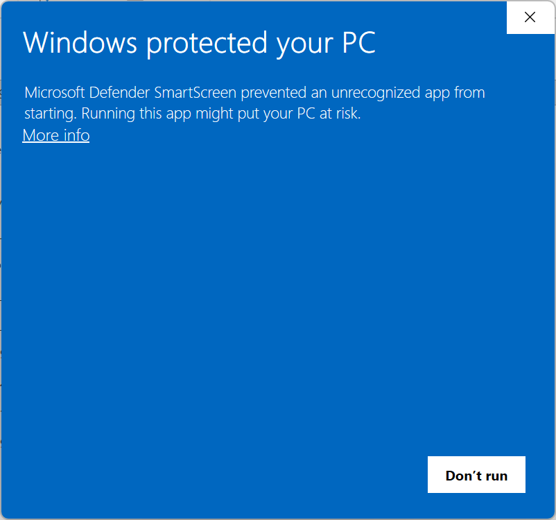

# 奇奇五笔输入法：下载、安装与常见问题

推荐使用 **MSI 安装包**。安装程序会自动完成安装和输入法添加，无需运行脚本。

## 1. 下载

打开[官方发布页面](https://github.com/cloudfyy/qiqiime/releases)，选择需要的版本，
展开 **Assets（附件）**，下载适合自己电脑的 `.msi` 文件。

| 电脑系统 | 选择的安装包 |
|---|---|
| Windows 11 x64、Windows 10 22H2 64 位 | 文件名含 `win-x64` |
| Windows 10 22H2 32 位 | 文件名含 `win-x86` |

不确定系统位数时，打开 **设置 → 系统 → 系统信息（关于）→ 系统类型** 查看。
64 位电脑只需安装 x64 包，已包含对 32 位应用的支持。目前没有原生 ARM64 安装包。

- 文件名以 **`zh-CN.msi`** 结尾：中文安装界面。
- 文件名以 **`en-US.msi`** 结尾：英文安装界面，不影响中文输入。
- 文件名中的版本号以发布页面为准。
- 不要下载 **Source code** 作为安装包。普通用户不需要源码、符号包或 ZIP 包。

只从官方页面下载。安装前可阅读[隐私政策](https://github.com/cloudfyy/qiqiime/blob/main/PRIVACY.md)；
如果发布页面提供文件校验值，请按说明核对。

## 2. 安装并开始使用

1. 双击下载好的 MSI。遇到下载或安全提示时，先看下方的[处理方法](#下载或打开时出现安全提示怎么办)。
2. 确认 Windows 的管理员权限提示，等待安装完成。标准账户可能需要管理员协助。
3. 重新打开记事本，点击输入区域。
4. 按 **Win + Space**，选择 **QiQi 五笔 86**。
5. 确认处于中文模式，输入 `wqiy` 试试“你”。默认可按 **Shift** 切换中英文。

安装后，可在开始菜单搜索“奇奇五笔”或“QiQiIME”：

- **设置**：调整输入习惯、候选显示、提示音等。
- **词典管理器**：管理用户词条、导入导出和备份。
- **日志监控器**：遇到问题时辅助排查，平时无需打开。

日常输入和修改设置通常不需要管理员权限。请不要移动或直接删除安装目录。

## 3. 升级

1. 先用词典管理器备份个人词库和设置。
2. 保存工作，切换到系统自带的输入法，并关闭使用奇奇五笔的应用。
3. 从官方发布页面下载适合系统的新版 MSI，双击安装。
4. 安装完成后重新打开应用；如果仍显示旧版，注销并重新登录，或重启电脑。

升级默认保留个人配置和用户词库。版本变化请查看发布页面的说明。

## 4. 卸载

1. 先备份需要保留的词库和设置。
2. 切换到其他输入法，关闭使用奇奇五笔的应用。
3. 打开 **设置 → 应用 → 安装的应用**（Windows 10 为“应用和功能”），
   找到奇奇五笔 / QiQiIME，点击 **卸载**。
4. 按提示确认；如仍看到旧输入法，注销并重新登录。

**默认不删除个人配置和用户词库。** 包含数据清理功能的新版安装包会提供
“同时删除当前用户的配置和默认用户词库”选项，默认不勾选：

- 想以后继续使用原有设置和词库：**保持不勾选**。
- 确定不再需要默认数据：先备份，再勾选并确认卸载。删除后无法恢复。

该选项仅清理当前用户的默认数据，不删除自定义路径中的词库、导出、备份或其他用户的数据。
旧安装包可能没有此选项。若有文件占用或权限问题，部分数据可能保留，请根据错误提示处理。
不要直接删除程序文件夹来代替卸载。

## 5. 常见问题

### 下载或打开时出现安全提示怎么办？

小众软件或新发布的文件可能出现信誉提示，**不等于已检测到病毒，也不代表文件一定安全**。
只有确认文件来自官方发布页面、文件名正确且没有恶意软件告警时，才考虑继续。

**Edge 提示“通常不会下载”**

1. 按 **Ctrl + J** 打开下载列表。
2. 点击该文件右侧的 **`…` → 保留**。
3. 在后续确认框中，点击“删除”旁的向下箭头，选择 **仍然保留**。
4. 再次核对来源后打开文件。

不同 Edge 版本的文字可能略有差异；注意操作的是该文件的菜单，而不是整个下载面板的菜单。

**Windows 提示“已保护你的电脑”**



确认信任文件后，点击 **更多信息（More info）**，核对应用名称和发布者，
再选择 **仍要运行（Run anyway）**。

**不要关闭防病毒软件或 SmartScreen。** 来源不明、文件校验不一致、
Defender 明确报告恶意软件时，请停止安装。如果没有继续按钮，可能是设备或组织策略限制，
请联系管理员，不要绕过限制。

### 安装完成了，但 Win + Space 里没有奇奇五笔？

1. 关闭并重新打开应用，再试一次。
2. 打开 **设置 → 时间和语言 → 语言和区域 → 中文（简体，中国）→ 语言选项 → 键盘**，
   检查或添加奇奇五笔。没有中文（简体，中国）时，先添加该语言。
3. 保存工作后注销并重新登录，必要时重启电脑。

不同 Windows 版本的菜单名称略有差异。如果由另一个管理员账户代为安装，
实际使用者也可能需要在自己的语言设置中添加输入法。

### 为什么输入的还是英文字母？

先按 **Win + Space** 确认选中了奇奇五笔，再按 **Shift** 切换到中文模式。
识别到密码或 PIN 输入框时，奇奇五笔会临时切换到英文模式，离开后恢复之前的中英文状态，
不需要专门切换到系统自带的输入法。部分应用的特殊输入框可能无法识别，若未自动切换，请手动切至英文模式。

### 安装包提示不适用于此系统？

检查下载文件名和系统类型：64 位 Windows 选 `win-x64`，32 位 Windows 选 `win-x86`。
不要把 x86 包装到 64 位系统上。

### 升级或卸载时提示文件正在使用？

先保存工作，切换到其他输入法并关闭相关应用，再重试。
仍有提示时，重启电脑后再操作。不要强行删除安装目录或随意结束不认识的系统进程。

### 我的词库会丢失吗？

正常升级和默认卸载会保留个人数据。
建议定期在词典管理器中备份，并把备份和自定义词库放在程序安装目录之外。
不要直接修改安装目录中随程序提供的词库。

### 仍然无法安装或使用，如何反馈？

请在[项目 Issues](https://github.com/cloudfyy/qiqiime/issues)中说明：

- Windows 版本及系统位数；
- 下载的 MSI 完整文件名；
- 是首次安装、升级，还是卸载；
- 出错步骤、提示文字或截图。

反馈前遮盖用户名、私人路径和其他个人信息；不要公开上传个人词库、备份或未经检查的日志。

## 6. 可选：ZIP 手动部署

普通用户仍推荐 MSI。`QiQiIME-v<版本>-win-x64-x86.zip` 是完整程序包，
包含两种架构的程序、词库和部署脚本，**不是源码包，也不是解压即用的绿色版**。
请勿与 MSI 安装混用，也不要用这些脚本卸载 MSI 安装的版本。

### 安装

1. 从官方发布页面下载上述 ZIP，完整解压到一个以后不再移动的本地目录。
   不要在压缩包内直接运行程序。
2. 打开解压后的根目录（能看到 `scripts`、`x64`、`x86` 和 `data`），
   在资源管理器地址栏输入 `powershell` 并回车。
3. 运行以下命令，按提示授权管理员权限：

   ```powershell
   powershell -NoProfile -ExecutionPolicy Bypass -File .\scripts\register_ime.ps1 -AutoElevate
   ```

4. 重新打开应用，按 **Win + Space** 选择奇奇五笔。
   工具可在对应系统架构的目录中直接打开，例如 64 位系统的 `x64\QiQiIMESettings.exe`。
   ZIP 部署不会创建 MSI 的开始菜单快捷方式。

注册后不要移动或删除该目录；如需换位置，先注销，再从新位置重新注册。

### 卸载：默认保留个人数据

先备份，切换到其他输入法并关闭相关应用。在同一个解压根目录打开 PowerShell，运行：

```powershell
powershell -NoProfile -ExecutionPolicy Bypass -File .\scripts\unregister_ime.ps1 -AutoElevate
```

此命令只注销输入法，**不删除个人配置和词库，也不会删除解压目录**。
注销成功并关闭相关应用后，可以自行删除程序目录；如有文件占用，先重启电脑。
删除前检查目录内是否放了个人词库或备份。

### 卸载并删除当前用户的默认数据

确定不再需要默认数据，并已备份时，明确加上 **`-RemoveUserData`**：

```powershell
powershell -NoProfile -ExecutionPolicy Bypass -File .\scripts\unregister_ime.ps1 -AutoElevate -RemoveUserData
```

只有注销成功后才清理数据。删除范围与前面的 MSI 清理选项相同：
发起脚本的当前用户配置、默认词库、词频及已知缓存、同步文件；
不删除自定义路径中的词库、导出、备份或其他用户的数据。
请从自己的 PowerShell 窗口运行；即使授权时使用另一管理员账户，清理仍在发起账户下执行。

这是不可撤销的删除，不会再次询问。清理失败会报告错误，部分数据可能保留；
程序解压目录仍需自行删除。

**`-RemoveUserData` 仅适用于包含此功能的新版 ZIP。**
旧版本的脚本（v1.0.6 及以前）没有此参数，请勿照此命令执行。
