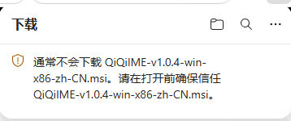
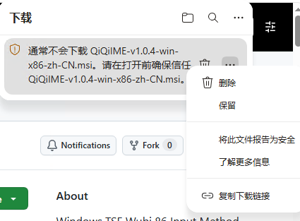
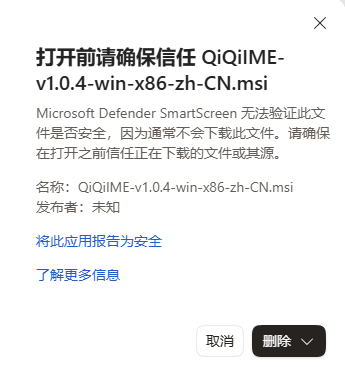
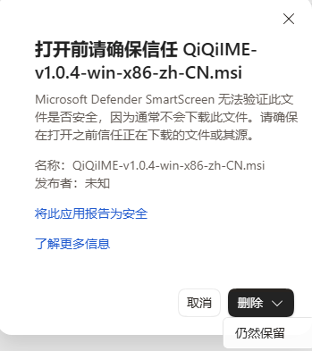
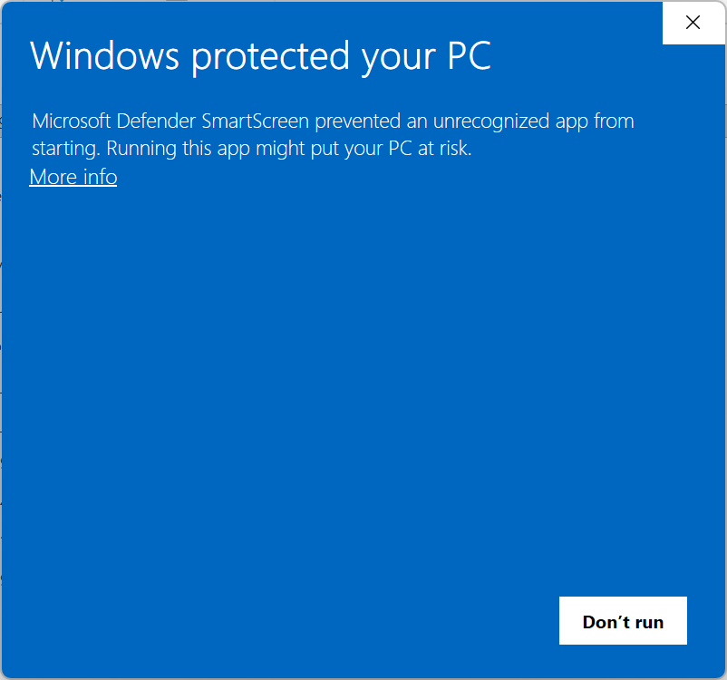

# 奇奇五笔输入法：下载、安装与常见问题

推荐使用 **MSI 安装包**。安装程序会自动完成安装和输入法添加，无需运行脚本。

## 1. 下载

打开[官方发布页面](https://github.com/cloudfyy/qiqiime/releases)，选择需要的版本，
展开 **Assets（附件）**，下载适合自己电脑的 `.msi` 文件。

| 电脑系统 | 选择的安装包 |
|---|---|
| Windows 11 x64、Windows 10 22H2 64 位 | 文件名含 `win-x64` |
| Windows 10 22H2 32 位 | 文件名含 `win-x86` |

不确定系统位数时，打开 **设置 → 系统 → 系统信息（关于）→ 系统类型** 查看。
64 位电脑只需安装 x64 包，已包含对 32 位应用的支持。目前没有原生 ARM64 安装包。

- 文件名以 **`zh-CN.msi`** 结尾：中文安装界面。
- 文件名以 **`en-US.msi`** 结尾：英文安装界面，不影响中文输入。
- 文件名中的版本号以发布页面为准。
- 不要下载 **Source code** 作为安装包。普通用户不需要源码、符号包或 ZIP 包。

只从官方页面下载。安装前可阅读[隐私政策](https://github.com/cloudfyy/qiqiime/blob/main/PRIVACY.md)；
如果发布页面提供文件校验值，请按说明核对。

## 2. 安装并开始使用

1. 双击下载好的 MSI。遇到下载或安全提示时，先看下方的[处理方法](#下载或打开时出现安全提示怎么办)。
2. 确认 Windows 的管理员权限提示，等待安装完成。标准账户可能需要管理员协助。
3. 重新打开记事本，点击输入区域。
4. 按 **Win + Space**，选择 **QiQi 五笔 86**。
5. 确认处于中文模式，输入 `wqiy` 试试“你”。默认可按 **Shift** 切换中英文。

安装后，可在开始菜单的 **QiQi** 文件夹中找到以下工具，也可直接搜索工具名称：

- **奇奇五笔设置 / QiQi Settings**：调整输入习惯、候选显示、提示音等。
- **词典管理器 / Dictionary Manager**：管理用户词条、导入导出和备份。
- **奇奇五笔日志监视器 / QiQi Log Monitor**：遇到问题时辅助排查，平时无需打开。

日常输入和修改设置通常不需要管理员权限。请不要移动或直接删除安装目录。

### 看不清文字或按钮

打开 **奇奇五笔设置 → 显示与易读**，可选择明亮、深色、高对比度或跟随系统，
放大文字，或启用关怀模式（Comfort mode）。开启时字号至少为 150%，
100%/125% 不可选；关闭后保留字号。仅点击开关可切换，文字区域不触发。
修改先预览，点击确定才保存；取消不改变显示偏好。
“恢复默认设置”统一恢复显示选项、词库和输入习惯等设置，点击确定才保存。
本批适用于设置和自绘候选窗，其他工具尚未全部接入。
操作、键盘与系统高对比度的边界见[显示与易读指南](accessibility.md)。
需要安装包含该功能的新版本；网站显示设置不会改变已安装的软件。

## 3. 升级

1. 先用词典管理器备份个人词库和设置。
2. 保存工作，切换到系统自带的输入法，并关闭使用奇奇五笔的应用。
3. 从官方发布页面下载适合系统的新版 MSI，双击安装。
4. 安装完成后重新打开应用；如果仍显示旧版，注销并重新登录，或重启电脑。

升级默认保留个人配置和用户词库。版本变化请查看发布页面的说明。

## 4. 卸载

1. 先备份需要保留的词库和设置。
2. 切换到其他输入法，关闭使用奇奇五笔的应用。
3. 打开 **设置 → 应用 → 安装的应用**（Windows 10 为“应用和功能”），
   找到 **QiQi**（旧版可能显示为奇奇五笔），点击 **卸载**。
4. 按提示确认；如仍看到旧输入法，注销并重新登录。

**默认不删除个人配置和用户词库。** 以下卸载向导从 `1.1.2` MSI 开始提供，
以 Release 页面实际发布的附件为准；既有 `v1.1.1` 安装包不包含该改动，
更新源码或创建标签不会改变旧包缓存的卸载流程。
向导语言跟随 MSI：`zh-CN` 为中文，`en-US` 为英文。

1. **选择数据**：分别提供“删除当前用户配置”和“删除当前用户词典数据”两个选项，
   默认均不勾选。词典数据包括默认用户词库、词频、已知编译缓存和同步文件；
   配置与词典可分别保留或删除。点击“开始卸载”前取消，不执行注销或数据清理。
2. **正在卸载**：卸载程序，处理所选数据。安装目录中的三个随附默认词库
   （极点、极点补充、海峰）始终随程序移除，不受个人数据选项影响。
3. **完成**：分别显示已清理、等待重启和未完成的状态。缓存仍被使用时，将旧文件
   安全隔离并登记重启删除。需要重启时请保存工作，使用 Windows 的 **重启**；
   不会强制立即重启，也不应例行要求手工删文件。

外部自定义源词库、导出、备份、未知文件和其他用户的数据保留；不会扫描磁盘、
按扩展名任意删除，或递归清空整个数据目录。删除后无法恢复，安装回滚不保证恢复
已删除的个人数据。权限、隔离或登记失败会明确报告，不能将部分清理当作全部完成。
程序卸载已提交后的个人数据清理问题不再导致整个程序卸载回滚。
不要直接删除程序文件夹来代替卸载。

### 静默卸载与兼容参数

静默卸载不显示向导，默认保留两类个人数据。显式指定
`QIQI_REMOVE_CONFIGURATION=1` 删除当前用户配置，或
`QIQI_REMOVE_DICTIONARIES=1` 删除当前用户词典数据；两者可同时指定。
仅接受 `0`／`1`。旧参数 `QIQI_REMOVE_USER_DATA=1` 继续表示两类都删除，
但显式指定的新参数优先；旧参数 `=0` 表示未另行指定的类别均保留。
升级移除旧版不会执行这些个人数据清理选项。

卸载返回 `0` 表示完成，`3010` 表示需要重启；已提交卸载但个人清理未完成会报告
失败和真实 HRESULT，须结合完成提示和 MSI 日志判断，而不是假定程序一定回滚。

### 提示上次卸载尚未完成重启

安装前会检查奇奇卸载留下的产品专用状态；未完成所需重启时，停止安装并提示重启。
注销不能代替重启，其他软件的普通“等待重启”标志不会单独阻止奇奇安装。
重启后还须确认隔离待删文件已经消失，才放行安装；权限不足或仍有残留会报告
未完成状态，不要求无依据地反复重启。静默安装同样执行检查，受阻时返回非成功状态
（`1603`），详情写入 MSI 日志。

## 5. 常见问题

### 下载或打开时出现安全提示怎么办？

小众软件或新发布的文件可能出现信誉提示，**不等于已检测到病毒，也不代表文件一定安全**。
只有确认文件来自官方发布页面、文件名正确且没有恶意软件告警时，才考虑继续。

**Edge 提示“通常不会下载”**

1. 按 **Ctrl + J** 打开下载列表。
2. 点击该文件右侧的 **`…` → 保留**。
3. 在后续确认框中，点击“删除”旁的向下箭头，选择 **仍然保留**。
4. 再次核对来源后打开文件。

不同 Edge 版本的文字可能略有差异；注意操作的是该文件的菜单，而不是整个下载面板的菜单。

以下为旧版中文 Edge 与旧版安装包的界面示意。请从官方发布页面下载当前版本，
不要按截图中的版本号下载。

| 下载提示与操作 | 截图 |
|---|---|
| 打开下载列表，找到“通常不会下载”的文件 |  |
| 打开该文件的 `…` 菜单，选择“保留” |  |
| 再次核对文件名与来源，点击“删除”旁的向下箭头 |  |
| 确认信任且没有恶意软件告警时，选择“仍然保留” |  |

**Windows 提示“已保护你的电脑”**



确认信任文件后，点击 **更多信息（More info）**，核对应用名称和发布者，
再选择 **仍要运行（Run anyway）**。

**不要关闭防病毒软件或 SmartScreen。** 来源不明、文件校验不一致、
Defender 明确报告恶意软件时，请停止安装。如果没有继续按钮，可能是设备或组织策略限制，
请联系管理员，不要绕过限制。

### 安装完成了，但 Win + Space 里没有奇奇五笔？

1. 关闭并重新打开应用，再试一次。
2. 打开 **设置 → 时间和语言 → 语言和区域 → 中文（简体，中国）→ 语言选项 → 键盘**，
   检查或添加奇奇五笔。没有中文（简体，中国）时，先添加该语言。
3. 保存工作后注销并重新登录，必要时重启电脑。

不同 Windows 版本的菜单名称略有差异。如果由另一个管理员账户代为安装，
实际使用者也可能需要在自己的语言设置中添加输入法。

### 为什么输入的还是英文字母？

先按 **Win + Space** 确认选中了奇奇五笔，再按 **Shift** 切换到中文模式。
识别到密码或 PIN 输入框时，奇奇五笔会临时切换到英文模式，离开后恢复之前的中英文状态，
不需要专门切换到系统自带的输入法。部分应用的特殊输入框可能无法识别，若未自动切换，请手动切至英文模式。

### 安装包提示不适用于此系统？

检查下载文件名和系统类型：64 位 Windows 选 `win-x64`，32 位 Windows 选 `win-x86`。
不要把 x86 包装到 64 位系统上。

### 升级或卸载时提示文件正在使用？

先保存工作，切换到其他输入法并关闭相关应用，再重试。
仍有提示时，重启电脑后再操作。不要强行删除安装目录或随意结束不认识的系统进程。

### 我的词库会丢失吗？

正常升级和默认卸载会保留个人数据。
建议定期在词典管理器中备份，并把备份和自定义词库放在程序安装目录之外。
不要直接修改安装目录中随程序提供的词库。

### 安装问题排查：收集 MSI 日志

下面两个脚本用于**重现安装或卸载并收集详细日志，不是只读检查**。
请先备份个人词库、保存工作、切换其他输入法并关闭相关应用，再以管理员身份打开
PowerShell，复制需要的一个脚本执行。不要同时运行两个脚本，也不要在另一个安装
尚未结束时运行。只使用确认来自官方或自己可信构建的 MSI，不要关闭安全软件或绕过组织策略。

- 日志使用不同的唯一文件名，保存在当前账户的临时目录，不覆盖之前的日志。
- 不会自动重启；脚本不会删除注册表、修改权限或绕过安装器的版本／待重启检查。
- 日志只能记录本次操作，不能补回之前没有采集的日志；不要为了采日志反复触发数据删除。
- MSI 和 ZIP 部署不要混用；以下卸载脚本不适用于 ZIP 手动部署。

#### 安装日志采集

按提示输入 MSI 完整路径，例如下载目录中的中文或英文安装包；
路径含空格或通过“复制文件地址”得到的两端引号均可。
脚本会实际启动所选包的安装流程；已安装时也可能进入升级或维护流程。

```powershell
$ErrorActionPreference = 'Stop'

$msi = (Read-Host '请输入可信 MSI 文件的完整路径').Trim().Trim('"')
$package = Get-Item -LiteralPath $msi -ErrorAction Stop
if ($package.PSIsContainer -or $package.Extension -ine '.msi') {
    throw '请选择一个 MSI 文件，脚本未执行安装。'
}

$log = Join-Path $env:TEMP (
    'QiQiIME-install-{0}-{1}.log' -f
        (Get-Date -Format 'yyyyMMdd-HHmmssfff'), [guid]::NewGuid().ToString('N')
)
$msiexec = Join-Path $env:SystemRoot 'System32\msiexec.exe'
$p = Start-Process -FilePath $msiexec -Wait -PassThru -ArgumentList (
    "/i `"$($package.FullName)`" /norestart /L*V! `"$log`""
)

"退出码：$($p.ExitCode)"
"日志位置：$log"
if (-not (Test-Path -LiteralPath $log -PathType Leaf)) {
    throw '安装器未生成日志，请保留上面的退出码和启动错误。'
}
notepad.exe "$log"
```

#### 卸载日志采集

脚本自动查找机器级 MSI 安装记录，不硬编码会随安装包变化的产品代码；
没有记录或发现多个目标时会停止，不会重新安装，也不会任选一个卸载。
使用基础交互界面（`/qb`），以便重现 Windows“设置”常见的卸载入口行为。
**是否删除个人数据仍由安装器中的选择决定，勾选会实际删除所选数据。**
为复现清理失败，保持与失败时相同的选择，不额外设置绕过清理的参数。

```powershell
$ErrorActionPreference = 'Stop'

$roots = @(
    'HKLM:\SOFTWARE\Microsoft\Windows\CurrentVersion\Uninstall',
    'HKLM:\SOFTWARE\WOW6432Node\Microsoft\Windows\CurrentVersion\Uninstall'
)
$apps = @(
    foreach ($root in $roots) {
        if (Test-Path -LiteralPath $root) {
            Get-ItemProperty -Path "$root\*" -ErrorAction Stop |
                Where-Object {
                    $_.PSObject.Properties['DisplayName'] -and
                    $_.PSObject.Properties['WindowsInstaller'] -and
                    $_.DisplayName -match 'QiQi|奇奇' -and
                    $_.WindowsInstaller -eq 1
                }
        }
    }
)

if ($apps.Count -eq 0) {
    throw '没有找到已安装的奇奇 MSI。若已卸载，无法补采之前的日志；不要为此反复安装卸载。'
}
if ($apps.Count -ne 1) {
    $apps | Select-Object DisplayName, DisplayVersion, PSChildName | Format-Table
    throw '发现多个安装记录，请先确认目标，脚本未执行卸载。'
}
$product = $apps[0].PSChildName
if ($product -notmatch '^\{[0-9A-Fa-f]{8}-[0-9A-Fa-f]{4}-[0-9A-Fa-f]{4}-[0-9A-Fa-f]{4}-[0-9A-Fa-f]{12}\}$') {
    throw '安装记录不是有效的 MSI 产品代码，停止操作。'
}

$log = Join-Path $env:TEMP (
    'QiQiIME-uninstall-{0}-{1}.log' -f
        (Get-Date -Format 'yyyyMMdd-HHmmssfff'), [guid]::NewGuid().ToString('N')
)
$msiexec = Join-Path $env:SystemRoot 'System32\msiexec.exe'
$p = Start-Process -FilePath $msiexec -Wait -PassThru -ArgumentList (
    "/x $product /qb /norestart /L*V! `"$log`""
)

"退出码：$($p.ExitCode)"
"日志位置：$log"
if (-not (Test-Path -LiteralPath $log -PathType Leaf)) {
    throw '安装器未生成日志，请保留上面的退出码和启动错误。'
}
notepad.exe "$log"
```

#### 日志和退出码怎么看

关闭提示并等待脚本结束后，保留退出码、日志路径和错误截图。常见退出码：

| 退出码 | 含义 |
|---|---|
| `0` | 本次操作完成 |
| `3010` | 操作完成，但需要重启；请先保存工作 |
| `1602` | 操作被取消，结合日志确认取消位置 |
| `1603` | 通用失败；查看更早的具体操作／HRESULT，不能仅凭它判断程序是否已经移除 |
| `1605` | 目标产品当前未安装，可能安装记录已经发生变化 |
| `1618` | 另一个安装事务正在运行，等待其结束，不要强杀安装器 |

使用同一个 PowerShell 窗口，可定位错误上下文：

```powershell
Select-String -LiteralPath $log -Pattern 'QiQiIME installer:', 'Return value 3', 'Error 1722', 'Error 1723' -Context 20,5
```

优先查看首个实际失败操作；清理故障要保留操作名称、HRESULT、已清理和待重启数量。
若日志已说明清理动作具有足够权限，但删除配置仍返回 `0x80070005`，不能简单归因于
“没有用管理员运行”：具体注册表子键仍可能没有授予删除权限。请保留操作名称和日志，
不要为消除报错而重置整个用户注册表的权限、强制接管所有子键或关闭安全保护。
**程序卸载已提交后的清理失败不代表程序文件回滚；登记重启删除也不代表已经删掉。**
反馈日志路径和相关错误段即可，分享前遮盖用户名、私人路径和其他个人信息，
不要公开上传未经检查的完整日志、词库或备份。

### 仍然无法安装或使用，如何反馈？

请在[项目 Issues](https://github.com/cloudfyy/qiqiime/issues)中说明：

- Windows 版本及系统位数；
- 下载的 MSI 完整文件名；
- 是首次安装、升级，还是卸载；
- 出错步骤、提示文字或截图。

反馈前遮盖用户名、私人路径和其他个人信息；不要公开上传个人词库、备份或未经检查的日志。

## 6. 可选：ZIP 手动部署

普通用户仍推荐 MSI。`QiQiIME-v<版本>-win-x64-x86.zip` 是完整程序包，
包含两种架构的程序、词库和部署脚本，**不是源码包，也不是解压即用的绿色版**。
请勿与 MSI 安装混用，也不要用这些脚本卸载 MSI 安装的版本。

### 安装

1. 从官方发布页面下载上述 ZIP，完整解压到一个以后不再移动的本地目录。
   不要在压缩包内直接运行程序。
2. 打开解压后的根目录（能看到 `scripts`、`x64`、`x86` 和 `data`），
   在资源管理器地址栏输入 `powershell` 并回车。
3. 运行以下命令，按提示授权管理员权限：

   ```powershell
   powershell -NoProfile -ExecutionPolicy Bypass -File .\scripts\register_ime.ps1 -AutoElevate
   ```

4. 重新打开应用，按 **Win + Space** 选择奇奇五笔。
   工具可在对应系统架构的目录中直接打开，例如 64 位系统的 `x64\QiQiIMESettings.exe`。
   ZIP 部署不会创建 MSI 的开始菜单快捷方式。

注册后不要移动或删除该目录；如需换位置，先注销，再从新位置重新注册。

### 卸载：默认保留个人数据

先备份，切换到其他输入法并关闭相关应用。在同一个解压根目录打开 PowerShell，运行：

```powershell
powershell -NoProfile -ExecutionPolicy Bypass -File .\scripts\unregister_ime.ps1 -AutoElevate
```

此命令只注销输入法，**不删除个人配置和词库，也不会删除解压目录**。
注销成功并关闭相关应用后，可以自行删除程序目录；如有文件占用，先重启电脑。
删除前检查目录内是否放了个人词库或备份。

### 卸载并删除当前用户的默认数据

确定不再需要默认数据，并已备份时，明确加上 **`-RemoveUserData`**：

```powershell
powershell -NoProfile -ExecutionPolicy Bypass -File .\scripts\unregister_ime.ps1 -AutoElevate -RemoveUserData
```

只有注销成功后才清理数据。删除范围与前面的 MSI 清理选项相同：
发起脚本的当前用户配置、默认词库、词频及已知缓存、同步文件；
不删除自定义路径中的词库、导出、备份或其他用户的数据。
请从自己的 PowerShell 窗口运行；即使授权时使用另一管理员账户，清理仍在发起账户下执行。

这是不可撤销的删除，不会再次询问。清理失败会报告错误，部分数据可能保留；
程序解压目录仍需自行删除。

**`-RemoveUserData` 仅适用于包含此功能的新版 ZIP。**
旧版本的脚本（v1.0.6 及以前）没有此参数，请勿照此命令执行。
